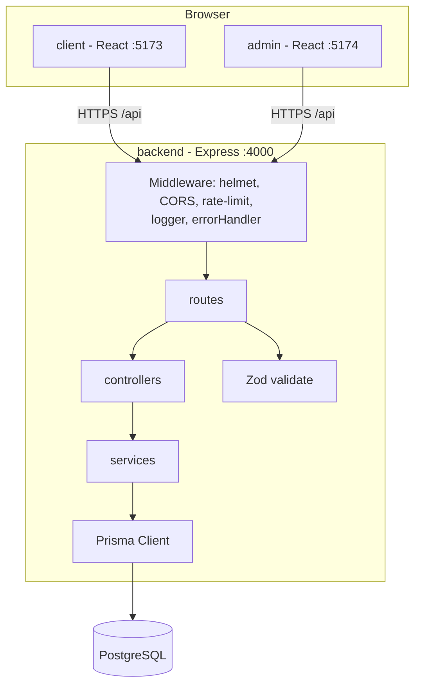
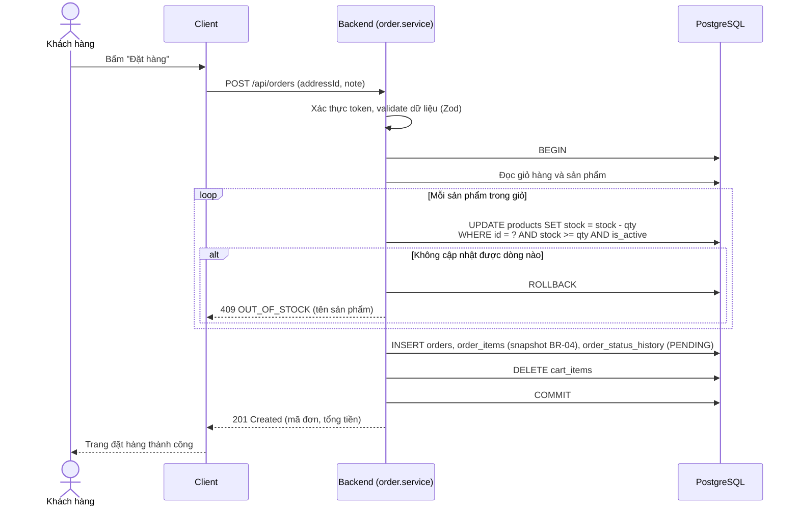
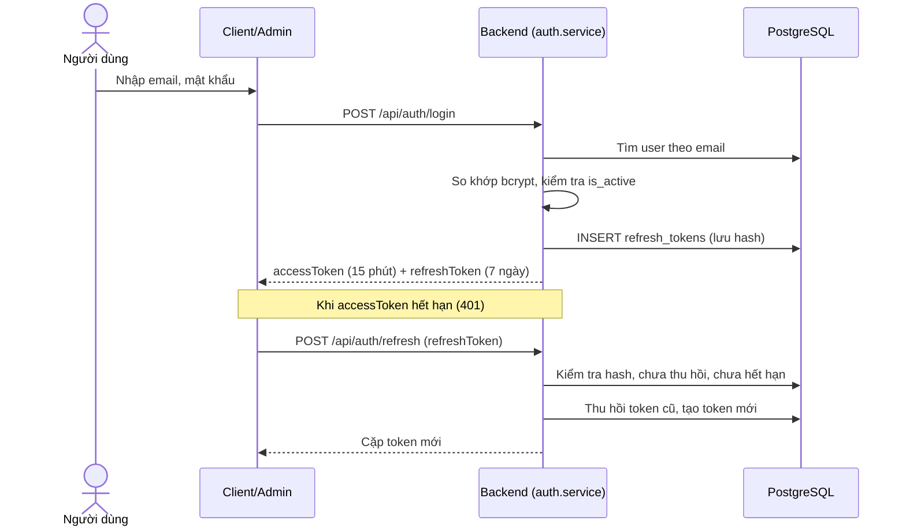
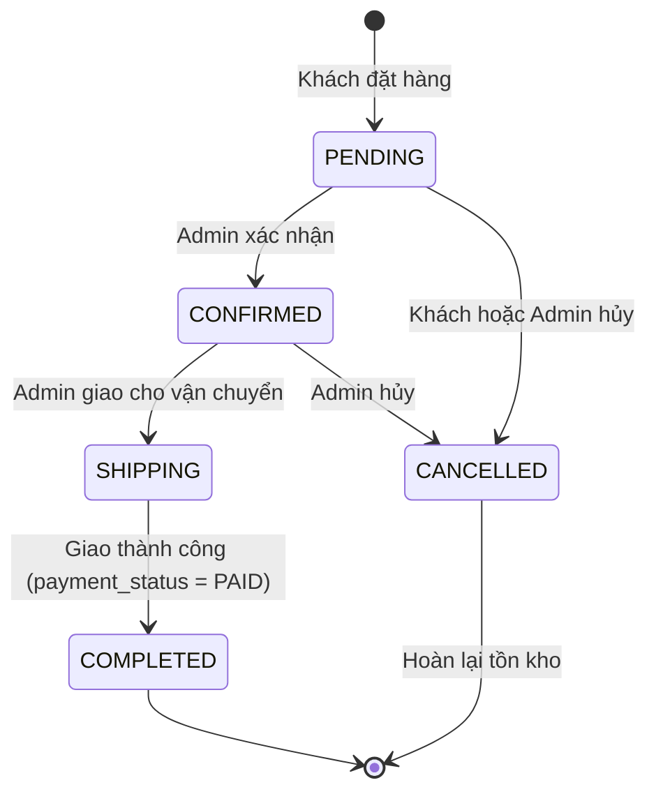
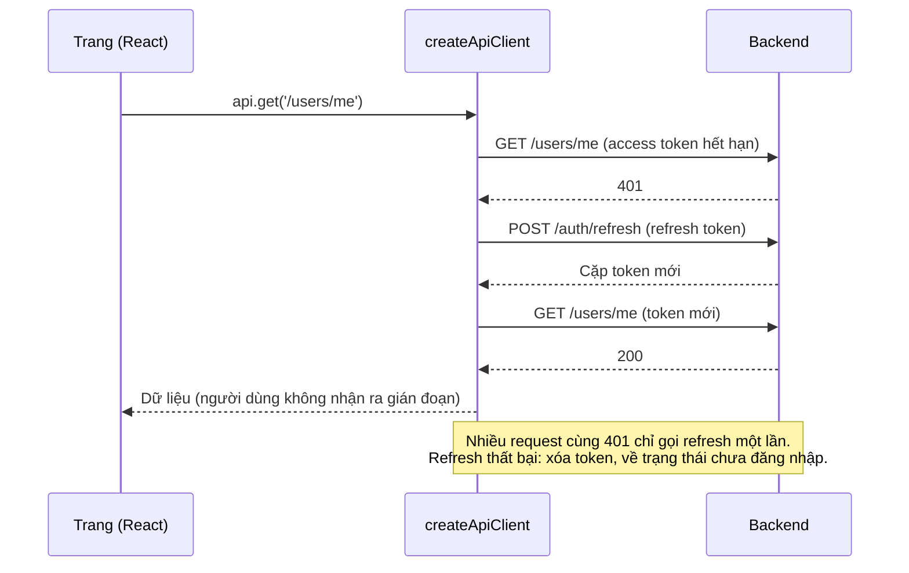

# Thiết kế hệ thống (SDD) - TechStore

Phục vụ rubric TC2.1. Sơ đồ dùng Mermaid (GitHub tự hiển thị). Mọi sơ đồ phải khớp mã nguồn: khi đổi code hoặc schema, cập nhật lại tài liệu này trong cùng commit.

Tài liệu liên quan: [SRS.md](SRS.md) · [DATA_DICTIONARY.md](DATA_DICTIONARY.md) · [schema.prisma](../backend/prisma/schema.prisma)

## 1. Quyết định kiến trúc và phương án đã cân nhắc

| Vấn đề            | Chọn                                                                   | Phương án khác đã cân nhắc                                | Lý do chọn                                                                                                    |
| ----------------- | ---------------------------------------------------------------------- | --------------------------------------------------------- | ------------------------------------------------------------------------------------------------------------- |
| Kiểu kiến trúc    | Monolith REST API + 2 SPA                                              | Microservices; Next.js SSR fullstack                      | Nhóm nhỏ, thời gian 6 tuần: monolith đơn giản, dễ triển khai và kiểm thử. Đề bài yêu cầu tách Client và Admin |
| CSDL              | PostgreSQL                                                             | MongoDB, MySQL                                            | Dữ liệu quan hệ rõ (đơn hàng, sản phẩm), cần transaction và ràng buộc CHECK cho tồn kho                       |
| Truy cập dữ liệu  | Prisma ORM                                                             | SQL thuần với `pg`, Sequelize, Knex                       | Có migration, schema là nguồn sự thật duy nhất và sinh được ERD; truy vấn tham số hóa chống SQL injection     |
| Xác thực          | JWT access token (15 phút) + refresh token (7 ngày, lưu hash trong DB) | Session cookie phía server; chỉ dùng access token dài hạn | SPA tách domain nên JWT tiện; refresh token lưu DB cho phép thu hồi khi đăng xuất hoặc khóa tài khoản         |
| Giỏ hàng          | Lưu trên server, yêu cầu đăng nhập                                     | Lưu localStorage cho khách vãng lai                       | Đơn giản, nhất quán giữa thiết bị; giảm khối lượng. Đánh đổi: khách chưa đăng nhập không thêm giỏ được        |
| Biến thể sản phẩm | Không có (mỗi cấu hình là một sản phẩm riêng, ví dụ iPhone 15 128GB)   | Bảng ProductVariant (màu, dung lượng)                     | Tiết kiệm thời gian; với quy mô đồ án đủ dùng. Có thể mở rộng sau                                             |
| Kiểu dữ liệu tiền | `Int` đơn vị VND                                                       | `Decimal`, `Float`                                        | VND không có phần lẻ; số nguyên tránh sai số làm tròn (BR-01)                                                 |
| Frontend          | React + Vite + Tailwind, React Query                                   | Create React App, Redux                                   | Vite nhanh; React Query lo việc gọi API, cache, trạng thái loading/lỗi nên không cần Redux                    |
| Kiểm thử          | Vitest (cả 3 phần), Supertest, Playwright (E2E)                        | Jest                                                      | Một công cụ cho mọi phần, cấu hình chung với Vite                                                             |
| Tách lớp backend  | route → controller → service → Prisma                                  | Gộp logic vào route                                       | Tách nghiệp vụ khỏi HTTP để dễ kiểm thử (rubric TC2.4)                                                        |

## 2. Sơ đồ ngữ cảnh (Context)


## 3. Sơ đồ thành phần (Component)



Cấu trúc thư mục backend khớp sơ đồ: `src/routes`, `src/controllers`, `src/services`, `src/middlewares`, `src/lib/prisma.js`, `src/config`, `src/utils`. Validate dùng Zod schema đặt ở `src/validators`. Hiện đã có: middleware, route health, cấu hình, tiện ích và toàn bộ lớp của F01; các tính năng sau thêm controller/service tương ứng.

## 4. Sơ đồ thực thể - quan hệ (ERD)

Khớp với `backend/prisma/schema.prisma` (các tính năng F00–F07). Review (F08), Wishlist (F08), Coupon (F09) chưa triển khai nên chưa có trong sơ đồ này.


Ghi chú: ngoài các cột trên, hầu hết bảng còn có `created_at` và `updated_at`. Ràng buộc CHECK (tồn kho không âm, giá dương, số lượng ≥ 1, tiền không âm) nằm ở cuối file migration `20261021000000_init`.

## 5. Sơ đồ tuần tự

### 5.1 Đặt hàng (F06, US-16)



Cách trừ kho `UPDATE ... WHERE stock >= qty` là một câu lệnh nguyên tử, nên nhiều đơn đồng thời không thể làm tồn kho âm (NFR-04); ràng buộc CHECK là lớp bảo vệ thứ hai.

### 5.2 Đăng nhập và làm mới phiên (F01, US-02, US-03)



## 6. Máy trạng thái đơn hàng (BR-06)



## 7. Sơ đồ triển khai (Deployment)

Nền tảng cụ thể chưa chốt (ưu tiên gói miễn phí); sơ đồ dưới là phương án dự kiến và sẽ cập nhật khi deploy.


Môi trường local: `docker-compose.yml` chạy PostgreSQL; backend và hai frontend chạy bằng `npm run dev:*`.

## 8. Nhật ký thay đổi thiết kế

| Ngày       | Thay đổi                                                                              | Lý do                                          |
| ---------- | ------------------------------------------------------------------------------------- | ---------------------------------------------- |
| 21/10/2026 | Chốt schema ban đầu F00–F07; không dùng biến thể sản phẩm; giỏ hàng yêu cầu đăng nhập | Phù hợp quy mô 6 tuần, giảm rủi ro trễ tiến độ |

## 9. Danh sách API đã triển khai

Định dạng lỗi chung: `{ "error": { "code", "message", "details?" } }`. Token gửi qua header `Authorization: Bearer <accessToken>`.

### F01 - Xác thực và phân quyền

| Method | Đường dẫn                   | Quyền     | Mô tả                                                             | User story |
| ------ | --------------------------- | --------- | ----------------------------------------------------------------- | ---------- |
| POST   | /api/auth/register          | Công khai | Đăng ký, tự đăng nhập, trả user và cặp token                      | US-01      |
| POST   | /api/auth/login             | Công khai | Đăng nhập (giới hạn `LOGIN_RATE_LIMIT` lần/15 phút/IP)            | US-02      |
| POST   | /api/auth/refresh           | Công khai | Đổi refresh token lấy cặp token mới (xoay vòng)                   | US-03      |
| POST   | /api/auth/logout            | Công khai | Thu hồi refresh token                                             | US-03      |
| GET    | /api/users/me               | Đăng nhập | Xem hồ sơ                                                         | US-04      |
| PATCH  | /api/users/me               | Đăng nhập | Sửa họ tên, số điện thoại                                         | US-04      |
| PUT    | /api/users/me/password      | Đăng nhập | Đổi mật khẩu, thu hồi mọi phiên                                   | US-04      |
| GET    | /api/users/me/addresses     | Đăng nhập | Danh sách địa chỉ                                                 | US-04      |
| POST   | /api/users/me/addresses     | Đăng nhập | Thêm địa chỉ                                                      | US-04      |
| PATCH  | /api/users/me/addresses/:id | Đăng nhập | Sửa địa chỉ                                                       | US-04      |
| DELETE | /api/users/me/addresses/:id | Đăng nhập | Xóa địa chỉ                                                       | US-04      |
| GET    | /api/admin/me               | ADMIN     | Kiểm tra quyền quản trị; mọi route /api/admin/* đều yêu cầu ADMIN | US-05      |

Mã lỗi thường gặp: `VALIDATION_ERROR` (400); `INVALID_CREDENTIALS`, `UNAUTHORIZED`, `INVALID_TOKEN`, `TOKEN_EXPIRED` (401); `ACCOUNT_LOCKED`, `FORBIDDEN` (403); `EMAIL_TAKEN` (409); `RATE_LIMITED` (429).

### F02 - Danh mục và thương hiệu

Danh mục (`categories`) và thương hiệu (`brands`) có cùng API, thay `{loại}` bằng `categories` hoặc `brands`.

| Method | Đường dẫn             | Quyền     | Mô tả                                                                        | User story   |
| ------ | --------------------- | --------- | ---------------------------------------------------------------------------- | ------------ |
| GET    | /api/{loại}           | Công khai | Chỉ các mục đang hiện, kèm số sản phẩm đang bán (không lộ trường nội bộ)     | US-06 AC3    |
| GET    | /api/admin/{loại}     | ADMIN     | Tất cả (kể cả đang ẩn) kèm tổng số sản phẩm; tham số `?search=` tìm theo tên | US-06, US-07 |
| POST   | /api/admin/{loại}     | ADMIN     | Tạo mới: tên duy nhất (không phân biệt hoa thường), slug tự sinh             | US-06, US-07 |
| GET    | /api/admin/{loại}/:id | ADMIN     | Xem chi tiết                                                                 | US-06, US-07 |
| PATCH  | /api/admin/{loại}/:id | ADMIN     | Sửa từng phần, đổi tên thì sinh lại slug; `isActive` để ẩn/hiện              | US-06, US-07 |
| DELETE | /api/admin/{loại}/:id | ADMIN     | Xóa; trả 409 `HAS_PRODUCTS` nếu đã có sản phẩm (chỉ được ẩn, BR-09)          | US-06 AC2    |

Mã lỗi thêm: `NAME_TAKEN` (409), `HAS_PRODUCTS` (409), `INVALID_NAME` (400, tên không tạo được slug).

Quyết định thiết kế F02:

- Hai loại dùng chung một "nhà máy" `createTaxonomyService` (`backend/src/services/taxonomy.service.js`) cùng controller và route tương ứng, tránh viết lặp. Giao diện Admin cũng dùng chung component `TaxonomyPage`.
- Tên duy nhất được kiểm tra ở ứng dụng (không phân biệt hoa thường) và slug duy nhất do ràng buộc `UNIQUE` của DB; lỗi tạo trùng cùng lúc cũng được bắt (mã `P2002`).
- Ảnh danh mục và logo thương hiệu nhập bằng đường dẫn http/https (chưa tải ảnh lên máy chủ); việc tải ảnh được làm ở F03 cho ảnh sản phẩm.
- Website khách hàng chỉ nhận dữ liệu tối thiểu: không có `isActive`, `createdAt`, `updatedAt`.

### F03 - Sản phẩm

Tất cả đường dẫn dưới `/api/admin/products` đều yêu cầu vai trò ADMIN.

| Method | Đường dẫn                               | Mô tả                                                                                                                                          | User story   |
| ------ | --------------------------------------- | ---------------------------------------------------------------------------------------------------------------------------------------------- | ------------ |
| GET    | /api/admin/products                     | Danh sách phân trang `{ items, page, pageSize, total }`; tham số `search`, `categoryId`, `brandId`, `isActive`, `page`, `pageSize` (tối đa 50) | US-09 AC3    |
| POST   | /api/admin/products                     | Tạo sản phẩm; SKU chuyển thành chữ hoa và duy nhất, slug tự sinh                                                                               | US-08        |
| GET    | /api/admin/products/:id                 | Chi tiết kèm thông số, danh mục, thương hiệu và danh sách ảnh theo thứ tự                                                                      | US-08        |
| PATCH  | /api/admin/products/:id                 | Sửa từng phần; `isActive` để ẩn/hiện; `salePrice: null` để bỏ khuyến mãi                                                                       | US-08, US-09 |
| DELETE | /api/admin/products/:id                 | Xóa; trả 409 `HAS_ORDERS` nếu đã nằm trong đơn hàng (chỉ được ẩn, BR-09); tự gỡ khỏi giỏ hàng và xóa file ảnh                                  | US-09 AC2    |
| POST   | /api/admin/products/:id/images          | Tải ảnh lên (`multipart/form-data`, trường `images`, tối đa 6 file mỗi lần)                                                                    | US-08 AC6    |
| PUT    | /api/admin/products/:id/images/order    | Đặt thứ tự ảnh `{ imageIds: [...] }`; ảnh đầu tiên là ảnh đại diện                                                                             | US-08 AC6    |
| DELETE | /api/admin/products/:id/images/:imageId | Xóa ảnh (dòng trong DB và file trên đĩa)                                                                                                       | US-08 AC6    |

Ảnh đã tải lên được phục vụ công khai tại `GET /uploads/products/<uuid>.<jpg|png|webp>`.

Mã lỗi thêm: `SKU_TAKEN`, `SLUG_TAKEN`, `HAS_ORDERS` (409); `INVALID_CATEGORY`, `INVALID_BRAND`, `INVALID_SALE_PRICE`, `INVALID_IMAGE_TYPE`, `TOO_MANY_IMAGES`, `INVALID_IMAGE_ORDER`, `NO_FILE` (400); `IMAGE_TOO_LARGE` (413).

Quyết định thiết kế F03:

- **Kiểm tra loại ảnh bằng nội dung thật của file** (chữ ký đầu file: JPEG `FF D8 FF`, PNG `89 50 4E 47...`, WebP `RIFF....WEBP`), không tin tên file hay Content-Type do trình duyệt gửi, vì người dùng có thể đổi tên một file bất kỳ thành `.jpg` (US-08 AC6). File không hợp lệ không bao giờ được ghi ra đĩa.
- **Tên file do hệ thống sinh (UUID)**, không dùng tên người dùng gửi, nên không thể ghi đè file khác hay chèn `../` để ghi ra ngoài thư mục `uploads`. Hàm xóa file cũng kiểm tra đường dẫn nằm trong thư mục upload.
- **Thêm ảnh theo kiểu "cả lượt hoặc không gì cả"**: mọi file được kiểm tra loại và tổng số ảnh (tối đa 6) trước khi ghi; nếu bước ghi DB lỗi thì các file vừa ghi bị xóa để không để lại file mồ côi.
- Giới hạn 2MB mỗi ảnh được multer chặn khi đọc; file giữ trong bộ nhớ (tối đa 6 x 2MB) rồi mới ghi ra đĩa sau khi đã kiểm tra.
- Các quy tắc giá (BR-01, BR-02), tồn kho (BR-03) được kiểm tra ở ba lớp: Zod (dữ liệu gửi lên), service (so khớp với giá trị đang có khi chỉ sửa một trong hai giá) và ràng buộc CHECK của PostgreSQL.
- SKU luôn chuyển thành chữ hoa để duy nhất không phân biệt hoa thường; slug trùng (hai sản phẩm cùng tên) thì thêm SKU phía sau.
- Nơi lưu ảnh tách riêng ở `backend/src/lib/storage.js` để sau này đổi sang dịch vụ đám mây (xem [TECH_DEBT.md](TECH_DEBT.md), mục 2).
- API công khai cho khách xem sản phẩm (chỉ sản phẩm đang bán) làm ở F04.

### Quyết định bảo mật của F01

- Access token JWT sống 15 phút; refresh token là chuỗi ngẫu nhiên 256 bit sống 7 ngày, DB chỉ lưu bản băm SHA-256.
- Mỗi request đã xác thực đều đọc lại user từ DB, nên khóa tài khoản hoặc đổi vai trò có hiệu lực ngay.
- Refresh token được xoay vòng; dùng lại token đã thu hồi sẽ thu hồi mọi phiên của người dùng đó (phòng token bị đánh cắp).
- Đổi mật khẩu thu hồi mọi phiên. Đăng nhập dùng thông báo lỗi chung và băm giả khi email không tồn tại để không lộ email.
- Frontend lưu token trong localStorage (đơn giản hơn cookie httpOnly khi Client/Admin khác domain với API). Đánh đổi: rủi ro XSS cao hơn, giảm thiểu bằng việc React tự escape nội dung và không dùng `dangerouslySetInnerHTML`.

## 10. Giao diện F01 (frontend)

### Cấu trúc

```
shared/src/      createApiClient (axios tự gắn và làm mới token), createAuth (AuthProvider, useAuth),
                 tokenStorage, errors, validation, useFormState, ui/ (Button, FormField, Alert)
client/src/      lib/api.js, context/AuthContext.jsx, components/ (Layout, ProtectedRoute, profile/*), pages/
admin/src/       lib/api.js, context/AuthContext.jsx (chỉ cho ADMIN), components/ (AdminLayout, ProtectedRoute), pages/
```

Client và Admin dùng chung `shared` để không viết lặp logic đăng nhập; mỗi ứng dụng lưu token ở một key localStorage riêng (`techstore.client.auth`, `techstore.admin.auth`) nên không đè phiên của nhau.

### Route

| Ứng dụng | Đường dẫn             | Yêu cầu       | Trang                                    | User story   |
| -------- | --------------------- | ------------- | ---------------------------------------- | ------------ |
| Client   | `/dang-nhap`          | Công khai     | Đăng nhập                                | US-02        |
| Client   | `/dang-ky`            | Công khai     | Đăng ký                                  | US-01        |
| Client   | `/tai-khoan`          | Đã đăng nhập  | Hồ sơ, đổi mật khẩu, sổ địa chỉ (3 mục)  | US-04        |
| Admin    | `/dang-nhap`          | Công khai     | Đăng nhập quản trị                       | US-02, US-05 |
| Admin    | `/` và các trang khác | Vai trò ADMIN | Tổng quan (sẽ thay bằng dashboard ở F10) | US-05        |

### Luồng làm mới phiên (US-03)



### Quyết định thiết kế giao diện F01

- Quy tắc kiểm tra form (mật khẩu, email, số điện thoại) đặt ở `shared/src/validation.js`, giống hệt backend để báo lỗi ngay; backend vẫn kiểm tra lại.
- Nút gửi form bị khóa khi đang xử lý để người dùng không gửi hai lần.
- Admin chỉ chấp nhận vai trò ADMIN ở tầng giao diện (`isAllowed`) và backend vẫn chặn `/api/admin/*` bằng quyền; giao diện chỉ là lớp thân thiện, không phải lớp bảo mật.
- Khách hàng đăng nhập nhầm vào Admin sẽ bị thu hồi phiên ngay, không để token tồn tại.
