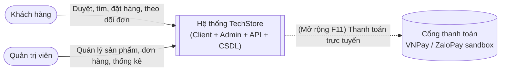
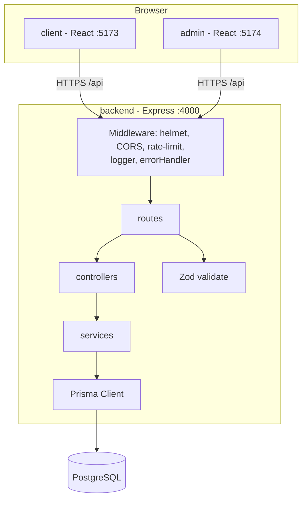
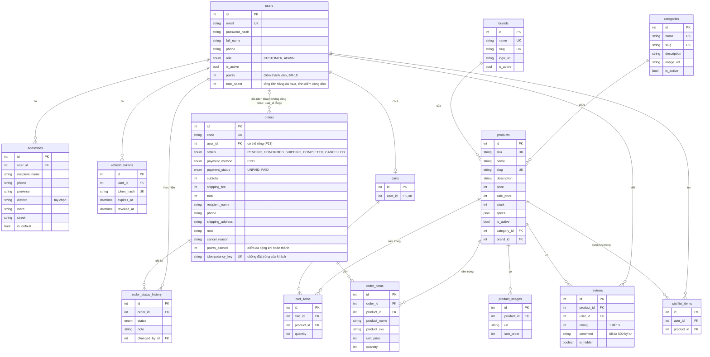
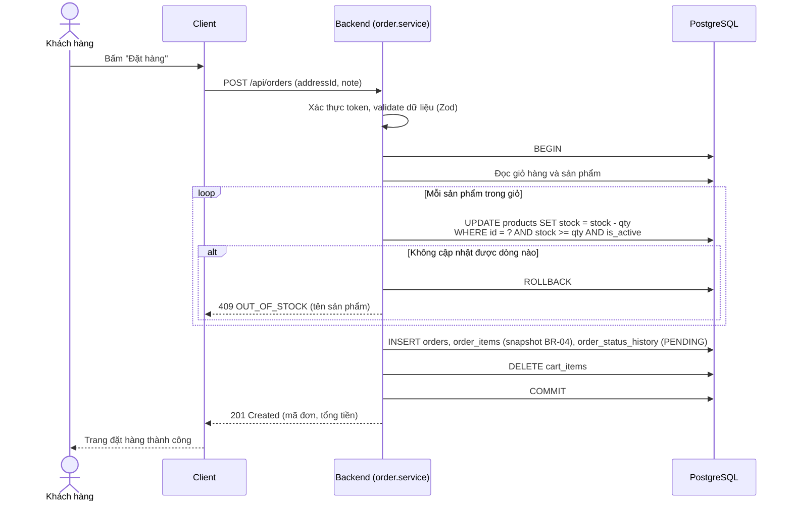
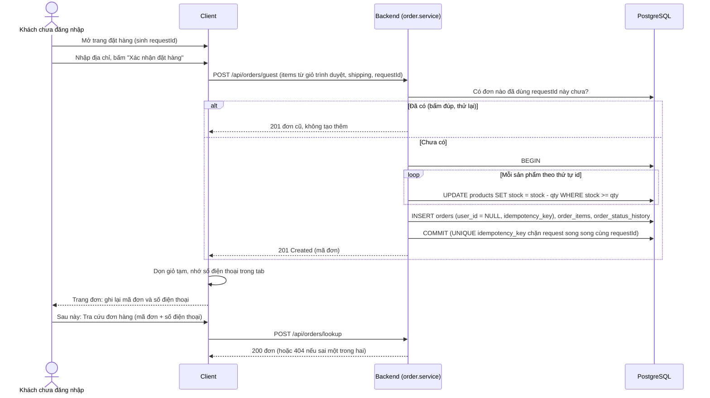
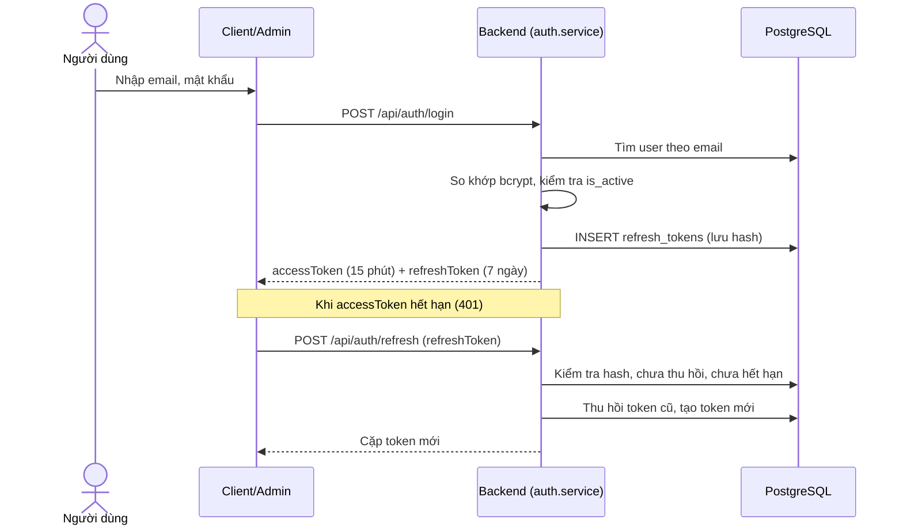
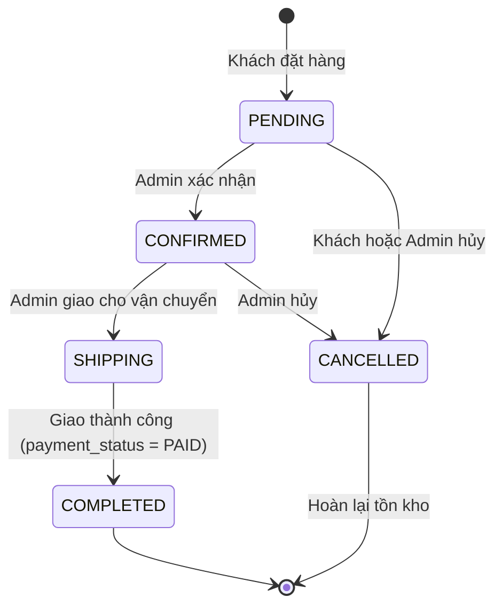
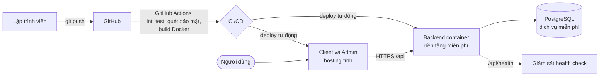
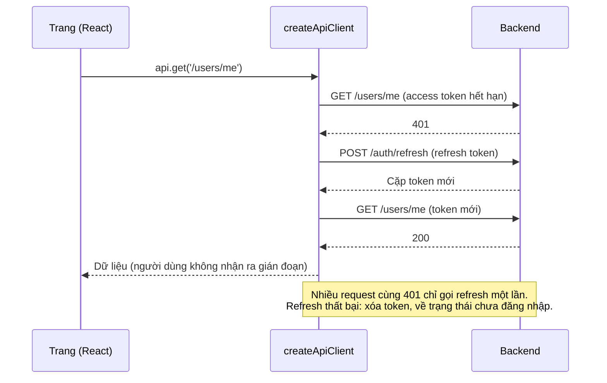

| `useCart` | Dùng chung cho khách đã và chưa đăng nhập (xem mục "Giỏ của khách" bên dưới). Với tài khoản: truy vấn giỏ bằng React Query# Thiết kế hệ thống (SDD) - TechStore

Phục vụ rubric TC2.1. Sơ đồ dùng Mermaid (GitHub tự hiển thị). Mọi sơ đồ phải khớp mã nguồn: khi đổi code hoặc schema, cập nhật lại tài liệu này trong cùng commit.

Tài liệu liên quan: [SRS.md](SRS.md) · [DATA_DICTIONARY.md](DATA_DICTIONARY.md) · [schema.prisma](../backend/prisma/schema.prisma)

## 1. Quyết định kiến trúc và phương án đã cân nhắc

| Vấn đề            | Chọn                                                                   | Phương án khác đã cân nhắc                                | Lý do chọn                                                                                                    |
| ----------------- | ---------------------------------------------------------------------- | --------------------------------------------------------- | ------------------------------------------------------------------------------------------------------------- |
| Kiểu kiến trúc    | Monolith REST API + 2 SPA                                              | Microservices; Next.js SSR fullstack                      | Nhóm nhỏ, thời gian 6 tuần: monolith đơn giản, dễ triển khai và kiểm thử. Đề bài yêu cầu tách Client và Admin |
| CSDL              | PostgreSQL                                                             | MongoDB, MySQL                                            | Dữ liệu quan hệ rõ (đơn hàng, sản phẩm), cần transaction và ràng buộc CHECK cho tồn kho                       |
| Truy cập dữ liệu  | Prisma ORM                                                             | SQL thuần với `pg`, Sequelize, Knex                       | Có migration, schema là nguồn sự thật duy nhất và sinh được ERD; truy vấn tham số hóa chống SQL injection     |
| Xác thực          | JWT access token (15 phút) + refresh token (7 ngày, lưu hash trong DB) | Session cookie phía server; chỉ dùng access token dài hạn | SPA tách domain nên JWT tiện; refresh token lưu DB cho phép thu hồi khi đăng xuất hoặc khóa tài khoản         |
| Giỏ hàng          | Lưu trên server, yêu cầu đăng nhập                                     | Lưu localStorage cho khách vãng lai                       | Đơn giản, nhất quán giữa thiết bị; giảm khối lượng. Đánh đổi: khách chưa đăng nhập không thêm giỏ được        |
| Biến thể sản phẩm | Không có (mỗi cấu hình là một sản phẩm riêng, ví dụ iPhone 15 128GB)   | Bảng ProductVariant (màu, dung lượng)                     | Tiết kiệm thời gian; với quy mô đồ án đủ dùng. Có thể mở rộng sau                                             |
| Kiểu dữ liệu tiền | `Int` đơn vị VND                                                       | `Decimal`, `Float`                                        | VND không có phần lẻ; số nguyên tránh sai số làm tròn (BR-01)                                                 |
| Frontend          | React + Vite + Tailwind, React Query                                   | Create React App, Redux                                   | Vite nhanh; React Query lo việc gọi API, cache, trạng thái loading/lỗi nên không cần Redux                    |
| Kiểm thử          | Vitest (cả 3 phần), Supertest, Playwright (E2E)                        | Jest                                                      | Một công cụ cho mọi phần, cấu hình chung với Vite                                                             |
| Tách lớp backend  | route → controller → service → Prisma                                  | Gộp logic vào route                                       | Tách nghiệp vụ khỏi HTTP để dễ kiểm thử (rubric TC2.4)                                                        |

## 2. Sơ đồ ngữ cảnh (Context)



## 3. Sơ đồ thành phần (Component)



Cấu trúc thư mục backend khớp sơ đồ: `src/routes`, `src/controllers`, `src/services`, `src/middlewares`, `src/lib/prisma.js`, `src/config`, `src/utils`. Validate dùng Zod schema đặt ở `src/validators`. Hiện đã có: middleware, route health, cấu hình, tiện ích và toàn bộ lớp của F01; các tính năng sau thêm controller/service tương ứng.

## 4. Sơ đồ thực thể - quan hệ (ERD)

Khớp với `backend/prisma/schema.prisma` (các tính năng F00–F08 và F13). Coupon (F09) chưa triển khai nên chưa có trong sơ đồ này.



Ghi chú: ngoài các cột trên, hầu hết bảng còn có `created_at` và `updated_at`. Ràng buộc CHECK (tồn kho không âm, giá dương, số lượng ≥ 1, tiền không âm) nằm ở cuối file migration `20261021000000_init`; điểm không âm (F13) nằm ở `20261028000000_guest_checkout_points` và tổng đã mua không âm ở `20261029010000_points_cumulative`; số sao 1 đến 5 và bình luận tối đa 500 ký tự (F08) nằm ở `20261029000000_reviews_wishlist`, cùng ràng buộc UNIQUE `(product_id, user_id)` của đánh giá và `(user_id, product_id)` của yêu thích.

## 5. Sơ đồ tuần tự

### 5.1 Đặt hàng (F06, US-16)



Cách trừ kho `UPDATE ... WHERE stock >= qty` là một câu lệnh nguyên tử, nên nhiều đơn đồng thời không thể làm tồn kho âm (NFR-04); ràng buộc CHECK là lớp bảo vệ thứ hai.

### 5.1b Đặt hàng không cần đăng nhập (F13, US-32)



### 5.2 Đăng nhập và làm mới phiên (F01, US-02, US-03)



## 6. Máy trạng thái đơn hàng (BR-06)



## 7. Sơ đồ triển khai (Deployment)

Nền tảng cụ thể chưa chốt (ưu tiên gói miễn phí); sơ đồ dưới là phương án dự kiến và sẽ cập nhật khi deploy.



Môi trường local: `docker-compose.yml` chạy PostgreSQL; backend và hai frontend chạy bằng `npm run dev:*`.

## 8. Nhật ký thay đổi thiết kế

| Ngày       | Thay đổi                                                                                                                                                                                                                                                                                                                  | Lý do                                                                                                                   |
| ---------- | ------------------------------------------------------------------------------------------------------------------------------------------------------------------------------------------------------------------------------------------------------------------------------------------------------------------------- | ----------------------------------------------------------------------------------------------------------------------- |
| 21/10/2026 | Chốt schema ban đầu F00–F07; không dùng biến thể sản phẩm; giỏ hàng yêu cầu đăng nhập                                                                                                                                                                                                                                     | Phù hợp quy mô 6 tuần, giảm rủi ro trễ tiến độ                                                                          |
| 28/10/2026 | Giỏ hàng cho khách chưa đăng nhập (lưu trên trình duyệt, gộp vào tài khoản khi đăng nhập); thêm `POST /api/cart/preview` (công khai) và `POST /api/cart/merge`                                                                                                                                                            | Phản hồi người dùng thử: bắt đăng nhập ngay khi thêm vào giỏ gây cản trở; không đổi schema                              |
| 28/10/2026 | Đặt hàng không cần đăng nhập (F13): `orders.user_id` cho phép rỗng, thêm `idempotency_key`, `points_earned`, `users.points`; tra cứu và hủy đơn bằng mã đơn + số điện thoại; cộng điểm thành viên khi đơn hoàn thành                                                                                                      | Phản hồi người dùng thử lần hai: bắt đăng nhập mới được đặt hàng làm khách bỏ giỏ; mua hàng chỉ để tích điểm thành viên |
| 28/10/2026 | Dashboard thống kê và quản lý người dùng (F10): `GET /api/admin/stats`, `GET /api/admin/users`, `PATCH /api/admin/users/:id/status`; không đổi schema                                                                                                                                                                     | Hoàn thành chức năng bắt buộc F10 (US-26, US-27)                                                                        |
| 29/10/2026 | Đánh giá và yêu thích (F08): bảng `reviews`, `wishlist_items` (migration `20261029000000_reviews_wishlist`); `GET/POST /api/products/:slug/reviews`, `GET/PATCH .../reviews/mine`, `GET /api/admin/reviews`, `PATCH /api/admin/reviews/:id/visibility`, `GET/PUT/DELETE /api/wishlist`; API sản phẩm thêm trường `rating` | Hoàn thành chức năng F08 (US-21, US-22, US-23)                                                                          |
| 29/10/2026 | Đổi cách tính điểm thành viên (BR-15): cộng dồn theo tổng tiền hàng đã mua, 1.000.000 đ = 1 điểm; thêm `users.total_spent` (migration `20261029010000_points_cumulative` tính lại điểm của dữ liệu cũ); `GET /api/users/me` thêm `totalSpent`                                                                             | Yêu cầu của nhóm: điểm theo tổng giá trị mọi đơn hàng, không theo từng đơn                                              |
| 28/10/2026 | `addresses.district` cho phép rỗng; địa chỉ ghép bỏ phần trống                                                                                                                                                                                                                                                            | Nhiều địa phương đã bỏ cấp quận/huyện nên không thể bắt khách nhập                                                      |

## 9. Danh sách API đã triển khai

Định dạng lỗi chung: `{ "error": { "code", "message", "details?" } }`. Token gửi qua header `Authorization: Bearer <accessToken>`.

### F01 - Xác thực và phân quyền

| Method | Đường dẫn                   | Quyền     | Mô tả                                                             | User story |
| ------ | --------------------------- | --------- | ----------------------------------------------------------------- | ---------- |
| POST   | /api/auth/register          | Công khai | Đăng ký, tự đăng nhập, trả user và cặp token                      | US-01      |
| POST   | /api/auth/login             | Công khai | Đăng nhập (giới hạn `LOGIN_RATE_LIMIT` lần/15 phút/IP)            | US-02      |
| POST   | /api/auth/refresh           | Công khai | Đổi refresh token lấy cặp token mới (xoay vòng)                   | US-03      |
| POST   | /api/auth/logout            | Công khai | Thu hồi refresh token                                             | US-03      |
| GET    | /api/users/me               | Đăng nhập | Xem hồ sơ                                                         | US-04      |
| PATCH  | /api/users/me               | Đăng nhập | Sửa họ tên, số điện thoại                                         | US-04      |
| PUT    | /api/users/me/password      | Đăng nhập | Đổi mật khẩu, thu hồi mọi phiên                                   | US-04      |
| GET    | /api/users/me/addresses     | Đăng nhập | Danh sách địa chỉ                                                 | US-04      |
| POST   | /api/users/me/addresses     | Đăng nhập | Thêm địa chỉ                                                      | US-04      |
| PATCH  | /api/users/me/addresses/:id | Đăng nhập | Sửa địa chỉ                                                       | US-04      |
| DELETE | /api/users/me/addresses/:id | Đăng nhập | Xóa địa chỉ                                                       | US-04      |
| GET    | /api/admin/me               | ADMIN     | Kiểm tra quyền quản trị; mọi route /api/admin/* đều yêu cầu ADMIN | US-05      |

Mã lỗi thường gặp: `VALIDATION_ERROR` (400); `INVALID_CREDENTIALS`, `UNAUTHORIZED`, `INVALID_TOKEN`, `TOKEN_EXPIRED` (401); `ACCOUNT_LOCKED`, `FORBIDDEN` (403); `EMAIL_TAKEN` (409); `RATE_LIMITED` (429).

### F02 - Danh mục và thương hiệu

Danh mục (`categories`) và thương hiệu (`brands`) có cùng API, thay `{loại}` bằng `categories` hoặc `brands`.

| Method | Đường dẫn             | Quyền     | Mô tả                                                                        | User story   |
| ------ | --------------------- | --------- | ---------------------------------------------------------------------------- | ------------ |
| GET    | /api/{loại}           | Công khai | Chỉ các mục đang hiện, kèm số sản phẩm đang bán (không lộ trường nội bộ)     | US-06 AC3    |
| GET    | /api/admin/{loại}     | ADMIN     | Tất cả (kể cả đang ẩn) kèm tổng số sản phẩm; tham số `?search=` tìm theo tên | US-06, US-07 |
| POST   | /api/admin/{loại}     | ADMIN     | Tạo mới: tên duy nhất (không phân biệt hoa thường), slug tự sinh             | US-06, US-07 |
| GET    | /api/admin/{loại}/:id | ADMIN     | Xem chi tiết                                                                 | US-06, US-07 |
| PATCH  | /api/admin/{loại}/:id | ADMIN     | Sửa từng phần, đổi tên thì sinh lại slug; `isActive` để ẩn/hiện              | US-06, US-07 |
| DELETE | /api/admin/{loại}/:id | ADMIN     | Xóa; trả 409 `HAS_PRODUCTS` nếu đã có sản phẩm (chỉ được ẩn, BR-09)          | US-06 AC2    |

Mã lỗi thêm: `NAME_TAKEN` (409), `HAS_PRODUCTS` (409), `INVALID_NAME` (400, tên không tạo được slug).

Quyết định thiết kế F02:

- Hai loại dùng chung một "nhà máy" `createTaxonomyService` (`backend/src/services/taxonomy.service.js`) cùng controller và route tương ứng, tránh viết lặp. Giao diện Admin cũng dùng chung component `TaxonomyPage`.
- Tên duy nhất được kiểm tra ở ứng dụng (không phân biệt hoa thường) và slug duy nhất do ràng buộc `UNIQUE` của DB; lỗi tạo trùng cùng lúc cũng được bắt (mã `P2002`).
- Ảnh danh mục và logo thương hiệu nhập bằng đường dẫn http/https (chưa tải ảnh lên máy chủ); việc tải ảnh được làm ở F03 cho ảnh sản phẩm.
- Website khách hàng chỉ nhận dữ liệu tối thiểu: không có `isActive`, `createdAt`, `updatedAt`.

### F03 - Sản phẩm

Tất cả đường dẫn dưới `/api/admin/products` đều yêu cầu vai trò ADMIN.

| Method | Đường dẫn                               | Mô tả                                                                                                                                          | User story   |
| ------ | --------------------------------------- | ---------------------------------------------------------------------------------------------------------------------------------------------- | ------------ |
| GET    | /api/admin/products                     | Danh sách phân trang `{ items, page, pageSize, total }`; tham số `search`, `categoryId`, `brandId`, `isActive`, `page`, `pageSize` (tối đa 50) | US-09 AC3    |
| POST   | /api/admin/products                     | Tạo sản phẩm; SKU chuyển thành chữ hoa và duy nhất, slug tự sinh                                                                               | US-08        |
| GET    | /api/admin/products/:id                 | Chi tiết kèm thông số, danh mục, thương hiệu và danh sách ảnh theo thứ tự                                                                      | US-08        |
| PATCH  | /api/admin/products/:id                 | Sửa từng phần; `isActive` để ẩn/hiện; `salePrice: null` để bỏ khuyến mãi                                                                       | US-08, US-09 |
| DELETE | /api/admin/products/:id                 | Xóa; trả 409 `HAS_ORDERS` nếu đã nằm trong đơn hàng (chỉ được ẩn, BR-09); tự gỡ khỏi giỏ hàng và xóa file ảnh                                  | US-09 AC2    |
| POST   | /api/admin/products/:id/images          | Tải ảnh lên (`multipart/form-data`, trường `images`, tối đa 6 file mỗi lần)                                                                    | US-08 AC6    |
| PUT    | /api/admin/products/:id/images/order    | Đặt thứ tự ảnh `{ imageIds: [...] }`; ảnh đầu tiên là ảnh đại diện                                                                             | US-08 AC6    |
| DELETE | /api/admin/products/:id/images/:imageId | Xóa ảnh (dòng trong DB và file trên đĩa)                                                                                                       | US-08 AC6    |

Ảnh đã tải lên được phục vụ công khai tại `GET /uploads/products/<uuid>.<jpg|png|webp>`.

Mã lỗi thêm: `SKU_TAKEN`, `SLUG_TAKEN`, `HAS_ORDERS` (409); `INVALID_CATEGORY`, `INVALID_BRAND`, `INVALID_SALE_PRICE`, `INVALID_IMAGE_TYPE`, `TOO_MANY_IMAGES`, `INVALID_IMAGE_ORDER`, `NO_FILE` (400); `IMAGE_TOO_LARGE` (413).

Quyết định thiết kế F03:

- **Kiểm tra loại ảnh bằng nội dung thật của file** (chữ ký đầu file: JPEG `FF D8 FF`, PNG `89 50 4E 47...`, WebP `RIFF....WEBP`), không tin tên file hay Content-Type do trình duyệt gửi, vì người dùng có thể đổi tên một file bất kỳ thành `.jpg` (US-08 AC6). File không hợp lệ không bao giờ được ghi ra đĩa.
- **Tên file do hệ thống sinh (UUID)**, không dùng tên người dùng gửi, nên không thể ghi đè file khác hay chèn `../` để ghi ra ngoài thư mục `uploads`. Hàm xóa file cũng kiểm tra đường dẫn nằm trong thư mục upload.
- **Thêm ảnh theo kiểu "cả lượt hoặc không gì cả"**: mọi file được kiểm tra loại và tổng số ảnh (tối đa 6) trước khi ghi; nếu bước ghi DB lỗi thì các file vừa ghi bị xóa để không để lại file mồ côi.
- Giới hạn 2MB mỗi ảnh được multer chặn khi đọc; file giữ trong bộ nhớ (tối đa 6 x 2MB) rồi mới ghi ra đĩa sau khi đã kiểm tra.
- Các quy tắc giá (BR-01, BR-02), tồn kho (BR-03) được kiểm tra ở ba lớp: Zod (dữ liệu gửi lên), service (so khớp với giá trị đang có khi chỉ sửa một trong hai giá) và ràng buộc CHECK của PostgreSQL.
- SKU luôn chuyển thành chữ hoa để duy nhất không phân biệt hoa thường; slug trùng (hai sản phẩm cùng tên) thì thêm SKU phía sau.
- Nơi lưu ảnh tách riêng ở `backend/src/lib/storage.js` để sau này đổi sang dịch vụ đám mây (xem [TECH_DEBT.md](TECH_DEBT.md), mục 2).
- API công khai cho khách xem sản phẩm (chỉ sản phẩm đang bán) làm ở F04.

### F04 - Duyệt và tìm sản phẩm (API công khai, không cần đăng nhập)

| Method | Đường dẫn           | Mô tả                                                                                       | User story          |
| ------ | ------------------- | ------------------------------------------------------------------------------------------- | ------------------- |
| GET    | /api/products       | Danh sách `{ items, page, pageSize, total }`; tham số bên dưới                              | US-10, US-11, US-12 |
| GET    | /api/products/:slug | Chi tiết theo slug: mô tả, thông số, danh sách ảnh theo thứ tự, `inStock`; 404 nếu không có | US-13               |

Tham số của `GET /api/products`:

| Tham số                | Mặc định | Ý nghĩa                                                                                          |
| ---------------------- | -------- | ------------------------------------------------------------------------------------------------ |
| `page`, `pageSize`     | 1, 12    | Phân trang; `pageSize` tối đa 48                                                                 |
| `search`               | -        | Tìm theo tên, không phân biệt hoa thường; rỗng thì trả toàn bộ                                   |
| `category`, `brand`    | -        | Lọc theo **slug** của danh mục, thương hiệu                                                      |
| `minPrice`, `maxPrice` | -        | Lọc theo **giá bán hiện hành** (giá khuyến mãi nếu có, ngược lại giá gốc, BR-02); số nguyên đồng |
| `sort`                 | `newest` | `newest` (mới nhất), `price_asc`, `price_desc`; sắp xếp giá cũng theo giá bán hiện hành          |
| `onSale`               | -        | Chỉ nhận giá trị `true`: chỉ trả sản phẩm đang có giá khuyến mãi (`sale_price IS NOT NULL`)      |

Phản hồi chỉ chứa dữ liệu khách cần: `id, name, slug, price, salePrice, inStock, thumbnail, category{name,slug}, brand{name,slug}`. **Không lộ** tồn kho chính xác, SKU (ở danh sách), trạng thái ẩn/hiện, thời gian tạo.

Quyết định thiết kế F04:

- **Quy tắc hiển thị:** khách chỉ thấy sản phẩm đang bán **và** thuộc danh mục, thương hiệu đang hiện. Ẩn một danh mục thì mọi sản phẩm trong đó cũng biến mất khỏi website (US-06 AC3). Chi tiết của sản phẩm không thỏa các điều kiện này trả 404 (US-13 AC3).
- **Một đường truy vấn duy nhất cho lọc và sắp xếp:** danh sách dùng SQL thuần qua `Prisma.sql` vì Prisma chưa hỗ trợ sắp xếp theo `COALESCE(sale_price, price)`. Mọi giá trị người dùng đều đi qua tham số (không nối chuỗi) nên không bị SQL injection; riêng `ORDER BY` chỉ chọn trong danh sách cố định. Hai truy vấn dùng chung điều kiện: lấy id của trang hiện tại và đếm tổng; sau đó nạp thông tin đầy đủ theo id và xếp lại đúng thứ tự.
- **Ký tự `%` và `_` trong từ khóa được thoát** (`escapeLike`) để người dùng gõ `100%` tìm đúng chuỗi "100%", không khớp mọi sản phẩm.
- Chi tiết dùng **slug** (không dùng id) để đường dẫn dễ đọc, chia sẻ được.
- Hạn chế đã biết của tìm kiếm: chưa bỏ dấu tiếng Việt (gõ "dien thoai" không ra "Điện thoại"), xem [TECH_DEBT.md](TECH_DEBT.md).

### F05 - Giỏ hàng (giỏ tài khoản cần đăng nhập; giỏ khách lưu trên trình duyệt)

| Method | Đường dẫn           | Mô tả                                                                                    | User story |
| ------ | ------------------- | ---------------------------------------------------------------------------------------- | ---------- |
| GET    | /api/cart           | Giỏ của người dùng (tạo nếu chưa có) đã tính lại tổng tiền                               | US-14      |
| POST   | /api/cart/items     | `{ productId, quantity = 1 }`: thêm, đã có thì cộng dồn                                  | US-14      |
| PATCH  | /api/cart/items/:id | `{ quantity }`: đặt số lượng mới của một dòng (1 đến tồn kho)                            | US-15      |
| POST   | /api/cart/merge     | Gộp giỏ của khách vào giỏ tài khoản sau khi đăng nhập (xem bên dưới)                     | US-14      |
| POST   | /api/cart/preview   | **Công khai.** Tính giá, tồn kho, trạng thái cho giỏ lưu trên trình duyệt (xem bên dưới) | US-14      |
| DELETE | /api/cart/items/:id | Xóa một dòng khỏi giỏ                                                                    | US-15      |

Mọi thao tác đều trả về **toàn bộ giỏ** để giao diện cập nhật ngay:

```
{ items: [{ id, productId, quantity, product: { name, slug, price, salePrice, thumbnail, brand, category },
            unitPrice, lineTotal, stock, status }],
  totalQuantity, subtotal, canCheckout }
```

- `unitPrice` là giá bán hiện hành (BR-02: giá khuyến mãi nếu có). `stock` là số còn lại trong kho, trả riêng cho chủ giỏ để giới hạn ô số lượng và báo "chỉ còn n" (US-14 AC3).
- `status` của từng dòng: `OK`, `UNAVAILABLE` (sản phẩm, danh mục hoặc thương hiệu đã ẩn), `OUT_OF_STOCK`, `EXCEEDS_STOCK` (tồn kho giảm xuống dưới số lượng trong giỏ).
- `subtotal` chỉ cộng các dòng `OK`. `canCheckout` chỉ đúng khi giỏ không rỗng và mọi dòng đều `OK` (F06 dựa vào đây).
- `totalQuantity` cộng số lượng của mọi dòng, dùng cho biểu tượng giỏ ở đầu trang (US-14 AC4).

Mã lỗi thêm: `PRODUCT_NOT_FOUND`, `CART_ITEM_NOT_FOUND` (404); `INSUFFICIENT_STOCK`, `OUT_OF_STOCK`, `PRODUCT_UNAVAILABLE`, `CONFLICT` (409).

Quyết định thiết kế F05:

- **Không dùng bảng mới:** `Cart` (một giỏ cho mỗi người dùng, `userId` duy nhất) và `CartItem` (khóa duy nhất `cartId + productId`) đã có từ giai đoạn thiết kế CSDL, nên F05 không cần migration.
- **Không vượt tồn kho kể cả khi nhiều request cùng lúc (BR-03):** cộng dồn bằng một câu `UPDATE ... WHERE quantity <= stock - n` có điều kiện nằm ngay trong câu lệnh, không "đọc rồi ghi". Hai request cùng tạo dòng mới thì request thua (trùng khóa duy nhất) tự thử lại như cộng dồn. Có test: tồn 3, gửi 6 request cùng lúc thì đúng 3 thành công.
- **Chỉ thêm được sản phẩm khách đang thấy** (sản phẩm, danh mục, thương hiệu đều đang hiện). Sản phẩm ẩn trả 404 như không tồn tại để không lộ sự tồn tại của hàng đã ẩn.
- **Dòng của người khác trả 404**, không phải 403, để không lộ id dòng của giỏ khác (kiểm tra quyền sở hữu ngay trong truy vấn).
- **Giỏ hàng không giữ chỗ tồn kho:** tồn kho có thể đổi sau khi thêm, nên mỗi dòng có `status` và việc kiểm tra bắt buộc cuối cùng nằm ở lúc đặt hàng (F06). Giá luôn lấy hiện tại, giỏ không lưu giá cũ (BR-04 chỉ áp dụng cho đơn hàng).
- **Tạo giỏ lần đầu an toàn khi nhiều request cùng lúc:** dùng `ensureCart` (đọc, tạo, nếu trùng khóa duy nhất `userId` thì đọc lại giỏ của request thắng) thay cho `prisma.cart.upsert`, vì upsert của Prisma không nguyên tử và ném P2002 thành lỗi 500. Lỗi này được CI phát hiện (xem nhật ký AI, mục 30).
- Giới hạn 99 sản phẩm mỗi dòng để chặn số vô lý trước khi chạm CSDL.
- **Giỏ của khách (điều chỉnh 28/10/2026):** trình duyệt chỉ lưu `{ productId, quantity }`; giá, tồn kho và trạng thái luôn do máy chủ tính nên không bao giờ cũ.
  - `POST /api/cart/preview` nhận `{ items: [{ productId, quantity }] }` (tối đa 50 mục, mỗi mục 1 đến 99), trả cùng dạng giỏ như `GET /api/cart` nhưng id dòng là id sản phẩm. **Không ghi CSDL.** Sản phẩm không tồn tại bị bỏ qua, mục trùng được cộng số lượng. Đây là API công khai duy nhất của giỏ nên giới hạn kích thước danh sách để không bị lạm dụng.
  - `POST /api/cart/merge` (cần đăng nhập) nhận cùng dạng dữ liệu, trả `{ cart, notes }`. Khác với thêm từng sản phẩm, gộp **không báo lỗi khi thiếu hàng** mà thêm tối đa số lượng còn được phép và ghi chú lại (khách không nên mất cả giỏ vì một món hết hàng). Sản phẩm đã ẩn bị bỏ qua và chỉ báo số lượng, không lộ tên.
  - Cả thêm từng sản phẩm lẫn gộp dùng chung hàm `applyAdd` (cộng dồn bằng UPDATE có điều kiện tồn kho) nên BR-03 được đảm bảo như nhau.
- `clearCart(userId, db)` sẵn sàng cho F06 xóa giỏ trong cùng transaction với việc tạo đơn.

### F06 - Đặt hàng (COD; thành viên dùng giỏ tài khoản, khách xem F13 bên dưới)

| Method | Đường dẫn         | Mô tả                                                                                   | User story |
| ------ | ----------------- | --------------------------------------------------------------------------------------- | ---------- |
| POST   | /api/orders       | Tạo đơn từ giỏ hàng của người dùng: `{ addressId }` hoặc `{ shipping: {...} }`, `note?` | US-16      |
| GET    | /api/orders/:code | Xem một đơn của chính mình theo mã đơn; đơn của người khác trả 404                      | US-16      |

Danh sách đơn của khách, hủy đơn và quản lý của Admin làm ở F07 (xem bên dưới).

`POST /api/orders` nhận **đúng một** trong hai: `addressId` (địa chỉ trong sổ địa chỉ của chính người đặt) hoặc `shipping` (`recipientName, phone, province, ward, street` và `district` (không bắt buộc, rỗng = không có), cùng quy tắc với sổ địa chỉ). `note` tối đa 500 ký tự, rỗng coi như không có. Thành công trả `201` với đơn đầy đủ: `code, status, paymentMethod, paymentStatus, subtotal, shippingFee, total, recipientName, phone, shippingAddress, note, createdAt, items[], history[]`.

Mã lỗi thêm: `EMPTY_CART` (400); `ADDRESS_NOT_FOUND`, `ORDER_NOT_FOUND` (404); `CART_NOT_PURCHASABLE` (409, kèm `details.items`: danh sách `{ productId, name, requested, available, reason }` với `reason` là `UNAVAILABLE`, `OUT_OF_STOCK` hoặc `INSUFFICIENT_STOCK`). `AppError` được mở rộng để mang `details`.

Quyết định thiết kế F06:

- **Một transaction duy nhất (US-16 AC5):** khóa giỏ, kiểm tra và trừ tồn kho từng dòng, tạo đơn kèm các dòng và lịch sử, xóa giỏ. Bất kỳ bước nào lỗi thì tất cả được hoàn lại, nên không có đơn mà kho chưa trừ, cũng không có kho đã trừ mà không có đơn. Test kiểm chứng: giỏ có một sản phẩm đủ hàng và một sản phẩm hết hàng thì kho của sản phẩm đủ hàng **không** bị trừ.
- **Chống bán vượt (BR-03):** trừ kho bằng `UPDATE ... WHERE stock >= n` ngay trong câu lệnh (không đọc rồi ghi). Hai người cùng mua món còn 3 cái, mỗi người 2 cái thì đúng một người thành công. Ràng buộc `CHECK (stock >= 0)` của PostgreSQL là lớp bảo vệ cuối cùng. Các dòng được xử lý theo thứ tự id sản phẩm để hai đơn cùng lúc không khóa chéo nhau (deadlock).
- **Gom hết lỗi rồi báo một lần (US-16 AC4):** xử lý mọi dòng, gom các sản phẩm có vấn đề (đã ẩn, hết hàng, không đủ số lượng) rồi mới ném lỗi `409` để khách biết cần sửa gì; lỗi làm hoàn lại các lần trừ kho trước đó.
- **Chống đặt trùng khi bấm đúp (US-16 AC6):** giao dịch đầu tiên khóa dòng giỏ (`SELECT ... FOR UPDATE`) và xóa giỏ khi xong; giao dịch thứ hai phải chờ rồi thấy giỏ trống nên bị từ chối `EMPTY_CART`. Không cần cột khóa chống trùng nên không có migration. Giao diện cũng khóa nút trong lúc gửi.
- **Snapshot (BR-04):** đơn lưu bản sao tên, SKU, đơn giá (giá khuyến mãi nếu có, BR-02) của từng dòng và địa chỉ giao hàng dạng chuỗi; sửa sản phẩm hay xóa địa chỉ sau đó không làm đổi đơn cũ.
- **Mã đơn (BR-12):** `TSyymmdd-xxxx` theo ngày giờ Việt Nam; 4 ký tự ngẫu nhiên lấy từ bảng ký tự bỏ `0, O, 1, I` để khách đọc mã qua điện thoại không nhầm. Trùng mã (rất hiếm) do ràng buộc UNIQUE phát hiện thì tạo mã khác và làm lại transaction (tối đa 5 lần).
- **Phí vận chuyển (BR-05)** do backend tính (`lib/shipping.js`), Client chỉ hiển thị ước tính theo cùng quy tắc.
- **Địa chỉ đã lưu của người khác trả 404**, không lộ sự tồn tại; đơn của người khác cũng trả 404.
- Thanh toán COD: `paymentStatus = UNPAID` khi tạo (BR-08); chuyển `PAID` khi đơn hoàn thành làm ở F07.

### F13 - Đặt hàng không cần đăng nhập và điểm thành viên

| Method | Đường dẫn                 | Quyền     | Mô tả                                                                                                                                        | User story |
| ------ | ------------------------- | --------- | -------------------------------------------------------------------------------------------------------------------------------------------- | ---------- |
| POST   | /api/orders/guest         | Công khai | Khách đặt hàng: `{ items: [{ productId, quantity }], shipping: {...}, note?, requestId }` (giới hạn `GUEST_ORDER_RATE_LIMIT` lần/15 phút/IP) | US-32      |
| POST   | /api/orders/lookup        | Công khai | Xem đơn của khách: `{ code, phone }` (giới hạn `ORDER_LOOKUP_RATE_LIMIT` lần/15 phút/IP)                                                     | US-33      |
| POST   | /api/orders/lookup/cancel | Công khai | Khách tự hủy đơn: `{ code, phone, reason }`; chỉ khi đơn `PENDING`                                                                           | US-33      |

Các API đơn hàng có thêm trong phần đơn trả về: `isGuest` (đơn không có chủ tài khoản), `pointsEarned` (điểm đã cộng, 0 khi chưa hoàn thành), `pointsExpected` (điểm sẽ nhận, chỉ với đơn thành viên đang xử lý). `GET /api/users/me` trả thêm `points` và `totalSpent`. Admin: dòng danh sách có `isGuest`, `pointsEarned`; chi tiết có `customer` là `null` với đơn khách và kèm `customer.points` với thành viên.

Quyết định thiết kế F13:

- **Cùng một đường tạo đơn:** thành viên và khách dùng chung `reserveLines` (trừ kho có điều kiện, gom lỗi) và `insertOrder` (snapshot, lịch sử), chỉ khác nguồn dòng hàng (giỏ trong CSDL hay danh sách khách gửi) nên BR-02 đến BR-05 áp dụng như nhau. Sản phẩm khách gửi nhưng không tồn tại được báo như `UNAVAILABLE`.
- **Chống đặt trùng không có giỏ để khóa:** thành viên dựa vào khóa dòng giỏ; khách dùng `requestId` (UUID sinh mỗi lần mở trang đặt hàng) lưu vào cột `idempotency_key` có UNIQUE. Gửi lại cùng mã thì trả đơn đã tạo; hai request cùng mã chạy song song thì request thua bị UNIQUE chặn, transaction hoàn lại kho rồi trả đơn của request thắng. Test: 5 request song song cùng mã chỉ tạo đúng một đơn và kho chỉ bị trừ một lần. Cũng giải quyết một phần nợ #14 cho đường của khách.
- **Tra cứu bằng mã đơn + số điện thoại (BR-16):** `findFirst({ code, phone, userId: null })`. Sai một trong hai đều trả cùng 404 nên không lộ đơn có tồn tại; điều kiện `userId: null` bảo đảm đơn của thành viên không bị xem qua đường này. Mã đơn có 32^4 khả năng mỗi ngày nên không đủ an toàn một mình, vì vậy kèm số điện thoại và giới hạn tần suất theo IP (xem nợ kỹ thuật #19).
- **Số điện thoại không đưa lên đường dẫn:** Client nhớ số điện thoại của đơn vừa đặt hoặc vừa tra cứu trong `sessionStorage` (mất khi đóng tab); chưa có thì trang đơn chuyển sang trang tra cứu thay vì bắt đăng nhập.
- **Hủy đơn của khách:** dùng chung `changeStatus` với thành viên (khóa dòng đơn, chỉ từ `PENDING`, hoàn kho đúng một lần); dòng lịch sử có `changed_by_id` rỗng.
- **Điểm thành viên (BR-15), cộng dồn:** điểm = `floor(total_spent / 1.000.000)` với `total_spent` là tổng tiền hàng của mọi đơn đã hoàn thành. Điểm của một đơn là phần tăng thêm sau khi cộng đơn vào tổng: `calculatePoints(spentBefore, subtotal) = pointsForSpent(spentBefore + subtotal) - pointsForSpent(spentBefore)` (`lib/points.js`, bản sao ở `shared` để Client hiển thị điểm dự kiến, có test đối chiếu); nhờ vậy phần lẻ không mất và tổng điểm của các đơn luôn bằng điểm của tổng (có test). Điểm được cộng trong chính `changeStatus` khi chuyển sang `COMPLETED`: dòng đơn đang bị `FOR UPDATE` và luồng trạng thái chỉ cho đi tới `COMPLETED` một lần nên hai Admin bấm cùng lúc cũng chỉ cộng một lần (có test). Tổng đã mua được cộng bằng một `UPDATE ... SET total_spent = total_spent + n RETURNING` nguyên tử trên dòng người dùng, nên hai đơn của cùng một người hoàn thành đồng thời xếp hàng chờ nhau và mỗi đơn thấy đúng tổng trước đó (nếu cùng đọc tổng cũ thì cả hai đều tính 0 và mất điểm; có test chạy song song). `pointsExpected` của đơn đang xử lý chỉ là ước tính trên tổng hiện tại, vì các đơn khác của họ có thể hoàn thành trước. Migration tính lại dữ liệu cũ bằng hàm cửa sổ (xếp đơn theo thời điểm hoàn thành) và có test chạy chính các câu UPDATE đó. Ghi `orders.points_earned` để lịch sử đơn tự giải thích; `users.points` có `CHECK (points >= 0)`.
- **Không đổi điểm lấy ưu đãi:** điểm chỉ tích lũy theo yêu cầu hiện tại (xem nợ kỹ thuật #17).

### F07 - Quản lý đơn hàng

| Method | Đường dẫn                      | Quyền     | Mô tả                                                                                       | User story |
| ------ | ------------------------------ | --------- | ------------------------------------------------------------------------------------------- | ---------- |
| GET    | /api/orders                    | Đăng nhập | Đơn của chính mình, mới nhất trước; `status`, `page`, `pageSize` (tối đa 50)                | US-17      |
| POST   | /api/orders/:code/cancel       | Đăng nhập | Khách tự hủy đơn: `{ reason }` (3 đến 200 ký tự); chỉ khi đơn `PENDING`                     | US-18      |
| GET    | /api/admin/orders              | ADMIN     | Mọi đơn: lọc `status`, tìm `search` (mã đơn, tên hoặc số điện thoại người nhận), phân trang | US-19      |
| GET    | /api/admin/orders/:code        | ADMIN     | Chi tiết đơn kèm khách hàng, lịch sử (có người thực hiện) và `allowedNext`                  | US-19      |
| PATCH  | /api/admin/orders/:code/status | ADMIN     | `{ status, note? }`: đổi trạng thái theo luồng hợp lệ; hủy đơn bắt buộc có `note`           | US-19      |

Dòng của danh sách: `id, code, status, paymentStatus, total, createdAt, recipientName, itemCount, items[]` (3 sản phẩm đầu: tên, số lượng, ảnh), `moreItems`; riêng Admin có thêm `customer { id, fullName, email }`. Đơn trả về ở chi tiết có thêm `cancelReason`. Mã lỗi thêm: `INVALID_TRANSITION` (400), dùng chung cho đổi trạng thái sai luồng và khách hủy đơn đã được xử lý.

Quyết định thiết kế F07:

- **Luồng trạng thái (BR-06)** nằm ở `backend/src/lib/orderStatus.js` (`PENDING → CONFIRMED → SHIPPING → COMPLETED`, hủy khi `PENDING` hoặc `CONFIRMED`, không đi lùi). Đây là nguồn sự thật duy nhất cho khách lẫn Admin; `shared/src/orderStatus.js` giữ bản sao chỉ để giao diện hiện đúng nút và có test bảo đảm hai bản **giống hệt nhau**.
- **Một hàm đổi trạng thái dùng chung** (`changeStatus`) làm trong transaction: khóa dòng đơn (`SELECT ... FOR UPDATE`), đọc lại trạng thái hiện tại rồi mới kiểm tra luồng, nên hai thao tác cùng lúc trên một đơn (hai Admin cùng xác nhận, khách bấm hủy đúng lúc Admin xác nhận) phải xếp hàng và người đến sau bị từ chối. Có test cho cả ba tình huống.
- **Hoàn kho (BR-07):** hủy đơn (do khách hay Admin) cộng trả tồn kho từng sản phẩm đúng một lần, theo thứ tự id sản phẩm để các lần hủy đồng thời không khóa chéo nhau. Hủy hai lần cùng lúc chỉ hoàn kho một lần (có test).
- **Thanh toán COD (BR-08):** chuyển `COMPLETED` thì `paymentStatus` thành `PAID`; hủy thì giữ `UNPAID`.
- **Khách chỉ tự hủy khi `PENDING`;** đã xác nhận thì phải liên hệ cửa hàng (Admin vẫn hủy được `CONFIRMED`). Lý do hủy lưu vào `cancelReason` và vào lịch sử, kèm tiền tố ("Khách hàng hủy đơn: ..." hoặc "Cửa hàng hủy đơn: ...") để khách và Admin thấy rõ ai hủy.
- **Mọi lần đổi trạng thái ghi một dòng lịch sử** kèm người thực hiện; Admin thấy tên người thực hiện, khách thấy dòng thời gian.
- **Tìm kiếm của Admin** dùng SQL thuần với `ILIKE` và thoát ký tự `%`, `_` (Prisma `contains` không tự thoát chúng nên gõ `%` sẽ khớp mọi đơn; có test).
- Đơn của người khác trả 404 ở mọi API của khách, mã sai định dạng trả 400.

### F10 - Dashboard và quản lý người dùng

| Method | Đường dẫn                   | Quyền | Mô tả                                                                                                                     | User story |
| ------ | --------------------------- | ----- | ------------------------------------------------------------------------------------------------------------------------- | ---------- |
| GET    | /api/admin/stats            | ADMIN | Một lần trả đủ: `summary`, `revenueByDay` (30 ngày), `ordersByStatus`, `topProducts` (5), `lowStock`                      | US-26      |
| GET    | /api/admin/users            | ADMIN | Danh sách người dùng: `search` (email hoặc họ tên), `status` (`active` hoặc `locked`), `page`, `pageSize` (tối đa 50)     | US-27      |
| PATCH  | /api/admin/users/:id/status | ADMIN | `{ isActive: boolean }`: khóa hoặc mở khóa; khóa thì thu hồi mọi phiên đăng nhập; tự khóa mình trả 400 `CANNOT_LOCK_SELF` | US-27      |

Dòng người dùng: `id, email, fullName, phone, role, isActive, points, createdAt, orderCount` (không bao giờ có mật khẩu). Mã lỗi thêm: `CANNOT_LOCK_SELF` (400), `USER_NOT_FOUND` (404).

Quyết định thiết kế F10:

- **Không đổi schema:** mọi số liệu tính từ bảng có sẵn nên không có migration.
- **Ngày theo giờ Việt Nam (BR-17):** `created_at` lưu UTC dạng `timestamp` không múi giờ, nên SQL gắn UTC rồi mới đổi sang `Asia/Ho_Chi_Minh` (`(created_at AT TIME ZONE 'UTC') AT TIME ZONE 'Asia/Ho_Chi_Minh'`); gắn thẳng múi giờ Việt Nam vào cột không múi giờ sẽ lệch 14 tiếng. Cửa sổ 30 ngày bắt đầu từ 00:00 giờ Việt Nam của ngày đầu tiên. Có test ở các ranh giới 16:59:59 và 17:00:00 UTC.
- **Doanh thu theo ngày hoàn thành, không phải ngày đặt:** lấy từ dòng lịch sử `COMPLETED` (thời điểm thu tiền COD, BR-08). Ngày không có đơn vẫn có mặt với giá trị 0 để biểu đồ đủ 30 cột (điền ở service, không dựa vào SQL).
- **Chống tràn số:** `SUM` trên cột `int` của PostgreSQL trả `bigint` và JSON không chứa được `BigInt`, nên SQL ép kiểu rõ ràng và service đổi sang `Number`; doanh thu sản phẩm nhân `quantity::bigint * unit_price` vì từng dòng vẫn có thể vượt 2^31 khi gộp nhiều đơn (có test với tổng 4 tỷ).
- **Bán chạy** xếp theo số lượng, hòa thì theo doanh thu rồi theo mã sản phẩm để thứ tự luôn xác định.
- **Khóa tài khoản trong một transaction:** cập nhật `isActive` và thu hồi refresh token cùng lúc, để không có khoảng hở tài khoản đã khóa mà token làm mới vẫn dùng được. Access token còn hạn bị từ chối ở request kế tiếp vì `authenticate` luôn đọc lại người dùng từ CSDL (F01). Mở khóa không làm sống lại phiên cũ. Gọi lại với cùng trạng thái vẫn thành công.
- **Tìm kiếm người dùng** thoát `%`, `_`, `\` trước khi đưa vào `contains` (hàm dùng chung `lib/like.js`, trước đó F04 và F07 mỗi nơi giữ một bản sao).
- Mọi route nằm dưới `/api/admin` nên tự có kiểm tra quyền ADMIN; khách hàng nhận 403, chưa đăng nhập nhận 401 (có test cho từng route).

### F08 - Đánh giá và yêu thích

| Method | Đường dẫn                         | Quyền     | Mô tả                                                                                                                                      | User story |
| ------ | --------------------------------- | --------- | ------------------------------------------------------------------------------------------------------------------------------------------ | ---------- |
| GET    | /api/products/:slug/reviews       | Công khai | Đánh giá đang hiện của sản phẩm, mới nhất trước (`page`, `pageSize` tối đa 50, mặc định 5) kèm `summary` (`average`, `count`, `breakdown`) | US-21      |
| GET    | /api/products/:slug/reviews/mine  | Đăng nhập | `{ canReview, review }`: có đơn COMPLETED chứa sản phẩm hay không, và đánh giá của mình (kể cả khi đang bị ẩn)                             | US-21      |
| POST   | /api/products/:slug/reviews       | Đăng nhập | `{ rating, comment? }`: tạo đánh giá; 403 `REVIEW_NOT_ALLOWED` nếu chưa nhận hàng, 409 `REVIEW_EXISTS` nếu đã đánh giá                     | US-21      |
| PATCH  | /api/products/:slug/reviews/mine  | Đăng nhập | `{ rating, comment? }`: sửa đánh giá của mình; 404 `REVIEW_NOT_FOUND` nếu chưa có                                                          | US-21      |
| GET    | /api/wishlist                     | Đăng nhập | Thẻ sản phẩm yêu thích còn hiển thị, mới thêm trước (`items`, `total`)                                                                     | US-22      |
| PUT    | /api/wishlist/:id                 | Đăng nhập | Thêm sản phẩm có id này (idempotent); 404 nếu không hiển thị, 400 `WISHLIST_FULL` khi đủ 100                                               | US-22      |
| DELETE | /api/wishlist/:id                 | Đăng nhập | Bỏ sản phẩm có id này (idempotent, luôn 204)                                                                                               | US-22      |
| GET    | /api/admin/reviews                | ADMIN     | Mọi đánh giá kể cả đã ẩn: `search` (sản phẩm, email, họ tên, bình luận), `status` (`visible`, `hidden`), `rating`, `page`, `pageSize`      | US-23      |
| PATCH  | /api/admin/reviews/:id/visibility | ADMIN     | `{ isHidden: boolean }`: ẩn hoặc bỏ ẩn (idempotent); 404 `REVIEW_NOT_FOUND`                                                                | US-23      |

`GET /api/products` và `GET /api/products/:slug` có thêm `rating`: `{ average, count }` ở danh sách và `{ average, count, breakdown }` ở chi tiết (`average` là `null` khi chưa có đánh giá).

Quyết định thiết kế F08:

- **Điều kiện đánh giá (BR-13) kiểm tra ở máy chủ:** có `order_items` của sản phẩm thuộc đơn `COMPLETED` của đúng người đó. Đơn của khách không đăng nhập (`user_id` rỗng) không tính, vì không biết ai là chủ. `GET .../mine` trả `canReview` để Client biết nên hiện form hay lời giải thích, nhưng quyền thật vẫn do `POST` kiểm tra lại.
- **Một người một đánh giá bằng ràng buộc của CSDL:** `UNIQUE (product_id, user_id)`; hai request gửi cùng lúc chỉ một cái thành công, cái còn lại bắt lỗi `P2002` và trả 409 (có test chạy song song). Kiểm tra trước rồi mới tạo sẽ lọt trong khoảng hở giữa hai bước.
- **Điểm tính một lần cho cả trang danh sách:** `lib/rating.js` dùng `groupBy` theo `productId` cho đúng các id của trang (một truy vấn, không phải N truy vấn); làm tròn 1 chữ số ở JavaScript. Đánh giá bị ẩn không vào điểm và không vào `total` của danh sách công khai.
- **Hiển thị sản phẩm dùng chung một định nghĩa:** `lib/productVisibility.js` (sản phẩm đang bán, danh mục và thương hiệu đang hiện) được trang chi tiết, đánh giá và yêu thích cùng dùng, để ba nơi không lệch nhau. Sản phẩm không hiển thị thì mọi API đánh giá trả 404 như trang chi tiết.
- **Tên người viết rút gọn** ("Quốc P.") và không bao giờ trả email hay mã người dùng ở API công khai; Admin xem được email để xử lý vi phạm.
- **Sửa đánh giá không bỏ ẩn:** `isHidden` không nằm trong dữ liệu người viết gửi lên, nên người bị ẩn không thể tự bỏ ẩn bằng cách sửa. Người viết vẫn thấy đánh giá của mình (kèm cờ `isHidden`) để biết vì sao nó không hiện với người khác.
- **Yêu thích idempotent:** thêm hai lần hoặc hai request cùng lúc đều ra cùng kết quả (bắt `P2002`), bỏ sản phẩm không có trong danh sách vẫn 204. Id sản phẩm nằm trên đường dẫn (`:id`) giống `DELETE /api/cart/items/:id`.
- Chưa có xóa đánh giá của chính mình (xem TECH_DEBT.md).

### Quyết định bảo mật của F01

- Access token JWT sống 15 phút; refresh token là chuỗi ngẫu nhiên 256 bit sống 7 ngày, DB chỉ lưu bản băm SHA-256.
- Mỗi request đã xác thực đều đọc lại user từ DB, nên khóa tài khoản hoặc đổi vai trò có hiệu lực ngay.
- Refresh token được xoay vòng; dùng lại token đã thu hồi sẽ thu hồi mọi phiên của người dùng đó (phòng token bị đánh cắp).
- Đổi mật khẩu thu hồi mọi phiên. Đăng nhập dùng thông báo lỗi chung và băm giả khi email không tồn tại để không lộ email.
- Frontend lưu token trong localStorage (đơn giản hơn cookie httpOnly khi Client/Admin khác domain với API). Đánh đổi: rủi ro XSS cao hơn, giảm thiểu bằng việc React tự escape nội dung và không dùng `dangerouslySetInnerHTML`.

## 10. Giao diện F01 (frontend)

### Cấu trúc

```
shared/src/      createApiClient (axios tự gắn và làm mới token), createAuth (AuthProvider, useAuth),
                 tokenStorage, errors, validation, useFormState, ui/ (Button, FormField, Alert)
client/src/      lib/api.js, context/AuthContext.jsx, components/ (Layout, ProtectedRoute, profile/*), pages/
admin/src/       lib/api.js, context/AuthContext.jsx (chỉ cho ADMIN), components/ (AdminLayout, ProtectedRoute), pages/
```

Client và Admin dùng chung `shared` để không viết lặp logic đăng nhập; mỗi ứng dụng lưu token ở một key localStorage riêng (`techstore.client.auth`, `techstore.admin.auth`) nên không đè phiên của nhau.

### Route

| Ứng dụng | Đường dẫn             | Yêu cầu       | Trang                                   | User story   |
| -------- | --------------------- | ------------- | --------------------------------------- | ------------ |
| Client   | `/dang-nhap`          | Công khai     | Đăng nhập                               | US-02        |
| Client   | `/dang-ky`            | Công khai     | Đăng ký                                 | US-01        |
| Client   | `/tai-khoan`          | Đã đăng nhập  | Hồ sơ, đổi mật khẩu, sổ địa chỉ (3 mục) | US-04        |
| Admin    | `/dang-nhap`          | Công khai     | Đăng nhập quản trị                      | US-02, US-05 |
| Admin    | `/` và các trang khác | Vai trò ADMIN | Tổng quan (dashboard thống kê từ F10)   | US-05, US-26 |
| Admin    | `/nguoi-dung`         | Vai trò ADMIN | Quản lý người dùng (F10)                | US-27        |
| Admin    | `/danh-gia`           | Vai trò ADMIN | Quản lý đánh giá (F08)                  | US-23        |

### Luồng làm mới phiên (US-03)



### Quyết định thiết kế giao diện F01

- Quy tắc kiểm tra form (mật khẩu, email, số điện thoại) đặt ở `shared/src/validation.js`, giống hệt backend để báo lỗi ngay; backend vẫn kiểm tra lại.
- Nút gửi form bị khóa khi đang xử lý để người dùng không gửi hai lần.
- Admin chỉ chấp nhận vai trò ADMIN ở tầng giao diện (`isAllowed`) và backend vẫn chặn `/api/admin/*` bằng quyền; giao diện chỉ là lớp thân thiện, không phải lớp bảo mật.
- Khách hàng đăng nhập nhầm vào Admin sẽ bị thu hồi phiên ngay, không để token tồn tại.

## 11. Giao diện khách hàng F04 (Client)

### Route

| Đường dẫn         | Trang              | Ghi chú                                                                              | User story   |
| ----------------- | ------------------ | ------------------------------------------------------------------------------------ | ------------ |
| `/`               | Trang chủ          | Banner slider, cam kết dịch vụ, ô danh mục, khối khuyến mãi, 8 sản phẩm mới nhất     | US-10        |
| `/san-pham`       | Danh sách sản phẩm | Bộ lọc, sắp xếp, tìm kiếm, phân trang **đều nằm trên URL**                           | US-11, US-12 |
| `/san-pham/:slug` | Chi tiết sản phẩm  | Ảnh, giá, còn/hết hàng, mô tả, thông số; sản phẩm không có thì hiện "không tìm thấy" | US-13        |

Các tham số URL của trang danh sách trùng tên với tham số API (`search`, `category`, `brand`, `minPrice`, `maxPrice`, `sort`, `page`), nên chia sẻ đường dẫn, tải lại hay bấm Back đều đúng kết quả. Trang **không giữ state riêng cho bộ lọc**: đọc từ URL, đổi bộ lọc là ghi lên URL; tham số sai (`page=abc`) về mặc định thay vì làm hỏng trang.

### Thành phần

```
components/  ProductCard, ProductGrid (khung chờ / lỗi + Thử lại / rỗng), Price (khuyến mãi, %), Pagination, SearchBox
  layout/    AccountMenu, CategoryBar, Footer
  home/      HeroSlider, TrustStrip, CategoryTiles
  list/      FilterPanel, FilterDrawer, ActiveFilters
  detail/    ProductGallery (phóng to), StickyPriceBar
pages/       HomePage, ProductListPage, ProductDetailPage
```

### Quyết định thiết kế

- Mọi khối dữ liệu có đủ trạng thái biên (rubric TC2.2): đang tải, lỗi mạng kèm nút Thử lại, danh sách rỗng, trang vượt quá số trang.
- Khi đổi bộ lọc, bảng cũ vẫn hiện trong lúc tải kết quả mới (`keepPreviousData`), không nhấp nháy.
- Chi tiết 404 không thử lại (vô ích); lỗi khác thử lại một lần rồi mới báo.
- Trên điện thoại ô tìm kiếm xuống dòng riêng; lưới sản phẩm 2 cột (điện thoại), 3 cột (máy tính bảng), 4 cột (máy tính).

## 12. Hệ thống thiết kế giao diện (Client và Admin)

Sau khi làm xong F04, giao diện được thiết kế lại theo phong cách công nghệ để tăng trải nghiệm và độ tin cậy (đánh giá của nhóm: bản đầu "không gây ấn tượng, chưa đảm bảo UX/UI"). Toàn bộ Client và Admin dùng chung một bộ quy chuẩn đặt trong package `shared` nên hai ứng dụng luôn đồng nhất.

### Token thiết kế (`shared/src/theme.css`, Tailwind v4 `@theme`)

| Nhóm          | Giá trị                                                                                                                    |
| ------------- | -------------------------------------------------------------------------------------------------------------------------- |
| Màu chính     | `brand` (chàm/indigo) cho nút, liên kết, trạng thái chọn; `accent` (xanh cyan) cho điểm nhấn                               |
| Màu nền tối   | `ink` (xanh navy đậm) cho thanh đầu trang, chân trang, thanh bên Admin                                                     |
| Màu ngữ nghĩa | `rose` cho giá khuyến mãi và lỗi, `emerald` cho còn hàng/thành công                                                        |
| Chữ           | Tiêu đề: Space Grotesk; nội dung: Inter. Cả hai **tự host** (`@fontsource-variable`, có tập con tiếng Việt), không gọi CDN |
| Đổ bóng       | `shadow-card`, `shadow-card-hover`, `shadow-glow` (3 mức nổi)                                                              |
| Chuyển động   | `animate-fade-up`, `animate-fade-in`, `skeleton` (khung chờ lấp lánh), nền lưới `bg-tech-grid`                             |

### Thành phần dùng chung (`@techstore/shared`)

`Button` (primary/secondary/danger/ghost, cỡ sm/md/lg, vòng xoay khi đang xử lý), `FormField`, `SelectField`, `Alert` (có biểu tượng), `Logo`, và bộ biểu tượng SVG tự vẽ `icons.jsx` (không phụ thuộc thư viện ngoài, đều `aria-hidden`).

### Nguyên tắc UX áp dụng

- **Phân cấp thị giác rõ:** thanh đầu trang tối cố định (logo, ô tìm kiếm dạng viên thuốc, tài khoản), thanh danh mục cuộn ngang, nội dung nền sáng. Giá khuyến mãi luôn đỏ đậm, giá gốc gạch ngang, nhãn `-x%` nổi bật.
- **Trang chủ:** banner slider 3 slide (tự chạy 6 giây, dừng khi rê chuột hoặc đặt focus, **không tự chạy** nếu người dùng bật "giảm chuyển động"), dải cam kết dịch vụ, ô danh mục có biểu tượng, khối khuyến mãi (chỉ hiện khi có sản phẩm giảm giá), sản phẩm mới.
- **Danh sách:** bộ lọc là các nút bật/tắt (`aria-pressed`) kèm mức giá chọn nhanh và hộp chọn khuyến mãi; các bộ lọc đang áp dụng hiện thành "chip" bấm để bỏ từng cái; trên điện thoại bộ lọc nằm trong ngăn kéo.
- **Chi tiết:** ảnh phóng to theo vị trí chuột, khối giá nổi kèm số tiền tiết kiệm và cam kết, bảng thông số, sản phẩm liên quan, thanh giá dính ở đáy khi cuộn khuất khối giá. Chỗ đặt nút "Thêm vào giỏ" đã chừa sẵn cho F05.
- **Trạng thái biên có thiết kế riêng:** khung chờ (skeleton) thay cho chữ "Đang tải...", trạng thái rỗng có biểu tượng và hướng dẫn, lỗi có nút Thử lại.
- **Admin:** thanh bên tối có biểu tượng và thẻ người dùng, trang tổng quan có thẻ số liệu (sản phẩm, danh mục, thương hiệu), bảng bo tròn không xuống dòng, nút xóa dạng biểu tượng có `aria-label`; trên điện thoại thanh bên là ngăn kéo.

### Khả năng truy cập (accessibility)

- Mọi nút chỉ có biểu tượng đều có `aria-label` (ví dụ "Xóa", "Slide sau", "Đóng bộ lọc"); biểu tượng trang trí ẩn khỏi trình đọc màn hình.
- Menu thả xuống tài khoản: `aria-haspopup`, `aria-expanded`, đóng bằng Esc hoặc bấm ra ngoài. Ngăn kéo bộ lọc: `role="dialog"` + `aria-modal`, focus vào nút đóng khi mở và trả về nút mở khi đóng, khóa cuộn nền.
- Slider theo mẫu carousel của WAI-ARIA (`aria-roledescription`, nhãn "n trên 3"); chỉ slide đang hiện nằm trong cây truy cập nên Tab không rơi vào slide ẩn.
- Mục điều hướng đang xem có `aria-current="page"`; có thể thao tác hoàn toàn bằng bàn phím; hiệu ứng chuyển động tôn trọng `prefers-reduced-motion`.

### Đáp ứng nhiều kích thước màn hình

Thiết kế theo hướng điện thoại trước (mobile-first): lưới sản phẩm 2/3/4 cột, bộ lọc chuyển từ ngăn kéo (dưới 1024px) sang thanh bên, thanh bên Admin chuyển thành ngăn kéo. Đã kiểm tra bằng ảnh chụp ở 1440px và 390px.

### Ảnh sản phẩm mẫu

`backend/prisma/productArt.js` vẽ ảnh SVG minh họa (điện thoại, laptop, máy tính bảng, đồng hồ, tai nghe, sạc dự phòng, cáp) theo thương hiệu và tông màu, ghi vào `backend/uploads/seed/` (thư mục này không đưa lên Git) khi chạy seed. Nhờ vậy dữ liệu mẫu không phụ thuộc dịch vụ ảnh bên ngoài và đẹp hơn ảnh giữ chỗ.

## 13. Trải nghiệm mở rộng F12 (Client và Admin)

Tất cả là xử lý phía trình duyệt, **không đổi API và CSDL**. Dữ liệu người dùng lưu ở localStorage với các khóa có tiền tố `techstore.`: `theme`, `compare`, `recent`.

### Chế độ tối

- **Cách làm:** Tailwind v4 sinh màu từ biến CSS nên khi `<html data-theme="dark">` ta đảo thang màu xám (`--color-slate-*`) và các màu nền nhạt của thương hiệu trong `shared/src/theme.css`. Không phải sửa từng component. Phần còn lại xử lý bằng vài lớp bổ sung: `bg-white` đọc biến `--surface-card`, chữ màu thương hiệu/trạng thái (`text-brand-600`, `text-rose-600`...) đọc biến `--text-*` sáng hơn.
- **Vùng luôn tối** (`.surface-dark`: đầu trang, chân trang, banner, thanh bên Admin, panel đăng nhập) trả biến về giá trị gốc nên thiết kế dành cho nền tối không bị đảo; `.follow-theme` cho một phần tử bên trong (menu thả xuống tài khoản) theo chế độ hiện tại.
- **Không chớp nền trắng:** script nhỏ trong `index.html` đặt `data-theme` trước khi React chạy. Thứ tự ưu tiên: lựa chọn đã lưu, cài đặt hệ điều hành (`prefers-color-scheme`), sáng.
- `shared/src/theme.js` giữ trạng thái bằng `useSyncExternalStore` nên nhiều nút trên cùng trang luôn đồng bộ; localStorage bị chặn thì không lỗi.
- Quyết định: các lớp `bg-white`, `text-*` bổ sung đặt trong `@layer utilities` (sau Tailwind) để biến thể `hover:` có độ ưu tiên cao hơn vẫn thắng.

### So sánh sản phẩm

| Thành phần                 | Vai trò                                                                                                                                                |
| -------------------------- | ------------------------------------------------------------------------------------------------------------------------------------------------------ |
| `CompareContext`           | Danh sách chọn (tối đa 4, cùng danh mục), lưu localStorage, kiểm tra dữ liệu khi đọc (bỏ phần tử sai dạng), thông báo khi bị từ chối                   |
| `CompareButton`            | Nút tròn trên thẻ sản phẩm, nút có chữ ở trang chi tiết; `aria-pressed`                                                                                |
| `CompareBar`               | Thanh cố định ở đáy (cao 4,5rem): ảnh thu nhỏ, bỏ từng cái, xóa tất cả, nút "So sánh (n)" chỉ bấm được khi có từ 2 sản phẩm                            |
| `ComparePage` (`/so-sanh`) | Tải chi tiết từng sản phẩm bằng `useQueries`, gộp thông số, tô hàng khác nhau, lọc "chỉ khác biệt", nhãn "Giá tốt nhất" theo giá bán hiện hành (BR-02) |

- Chỉ lưu `slug, tên, ảnh, danh mục`; giá và thông số luôn tải mới từ API nên không bao giờ cũ.
- Sản phẩm 404 hoặc lỗi mạng chỉ làm hỏng cột của nó (có nút bỏ), các cột khác vẫn hiện.
- Nút so sánh nằm cạnh liên kết của thẻ sản phẩm, không lồng trong `<a>` (HTML không cho phép nút bên trong liên kết).
- Thanh giá dính ở trang chi tiết và nút "Lên đầu trang" tự nâng lên khi thanh so sánh đang hiện.

### Trang thông tin

`/gioi-thieu`, `/lien-he`, `/cau-hoi-thuong-gap`, `/chinh-sach`, `/chinh-sach/:slug`. Nội dung nằm trong `lib/policies.js` và `lib/storeInfo.js`, dùng chung cho trang, thanh tiện ích và chân trang. Các con số khớp quy tắc nghiệp vụ (BR-05 phí giao, BR-06 hủy đơn, BR-08 COD) và có test kiểm tra. Thông tin liên hệ là **dữ liệu mẫu** (ghi chú ngay trên trang Liên hệ). Câu hỏi thường gặp là bộ phận mở/đóng đạt chuẩn truy cập (`aria-expanded`, `hidden`), tìm không phân biệt dấu.

### Khối trang chủ mới và hiệu ứng

Thương hiệu nổi bật, banner đôi (chỉ hiện nếu danh mục tương ứng tồn tại), dải số liệu đếm thật từ API, "Bạn đã xem" (không lưu giá). `Reveal` (hiện dần khi cuộn) và `CountUp` (số chạy) dùng `IntersectionObserver`; không có IntersectionObserver hoặc người dùng bật "giảm chuyển động" thì hiển thị ngay, nội dung không bao giờ bị ẩn mãi.

### Ảnh sản phẩm thật

Ảnh do quản trị viên tải lên ở Admin hiển thị bằng `object-contain` trên nền trắng (không cắt xén ảnh nhiều tỉ lệ). Ảnh SVG mẫu của seed là hình vuông nên vẫn lấp đầy ô.

## 14. Giao diện giỏ hàng F05 (Client)

| Thành phần                 | Vai trò                                                                                                                                                                                                                                                                                                   |
| -------------------------- | --------------------------------------------------------------------------------------------------------------------------------------------------------------------------------------------------------------------------------------------------------------------------------------------------------- |
| `useCart`                  | Truy vấn giỏ bằng React Query với khóa `['cart', userId]` (đổi tài khoản không thấy giỏ người trước; chưa đăng nhập thì không gọi API). Mỗi thao tác ghi thẳng giỏ máy chủ trả về vào cache nên biểu tượng giỏ, trang giỏ và nút thêm luôn cùng một dữ liệu                                               |
| `AddToCartButton`          | Nút "Thêm vào giỏ" (thẻ sản phẩm dạng biểu tượng, trang chi tiết và thanh giá dính dạng đầy đủ). Chưa đăng nhập thì chuyển tới đăng nhập rồi quay lại đúng trang (US-14 AC1); hết hàng thì khóa; thành công đổi thành "Đã thêm" 2 giây; lỗi hiện đúng thông báo của máy chủ (vượt tồn kho kèm số còn lại) |
| `QuantityStepper`          | Nút − / ô nhập / nút +, tối thiểu 1, tối đa theo tồn kho; gõ số sai được đưa về giá trị hợp lệ thay vì gửi lên máy chủ                                                                                                                                                                                    |
| `CartPage` (`/gio-hang`)   | Danh sách dòng, tóm tắt đơn hàng, phí vận chuyển ước tính (BR-05) kèm thanh tiến độ "mua thêm ... để được miễn phí", trạng thái dòng, giỏ trống, khung chờ, lỗi và Thử lại                                                                                                                                |
| Biểu tượng giỏ ở đầu trang | Hiện tổng số lượng (hiện "99+" khi quá lớn); chưa đăng nhập thì dẫn tới trang đăng nhập (US-14 AC4)                                                                                                                                                                                                       |

- Dòng có vấn đề (`UNAVAILABLE`, `OUT_OF_STOCK`, `EXCEEDS_STOCK`) được viền đỏ kèm thông báo; `EXCEEDS_STOCK` có nút "Giảm xuống n" một cú bấm. Các dòng này không vào tổng tiền (US-15 AC4).
- Khi một thao tác bị máy chủ từ chối (ví dụ vượt tồn kho), ô số lượng được tạo lại để quay về số lượng thật, tránh hiện số mà giỏ không có.
- Phí vận chuyển ở `lib/shipping.js` là **ước tính**; giá trị cuối cùng do backend tính khi đặt hàng (F06). Hai nơi cùng áp BR-05 nên nếu quy tắc đổi phải sửa cả hai.
- Nút "Đặt hàng" đang bị khóa kèm ghi chú "sắp ra mắt" cho tới khi làm F06.
- Trên điện thoại hẹp, nút đổi giao diện sáng/tối chuyển xuống chân trang để đầu trang chứa vừa biểu tượng giỏ trên một hàng.

### Giỏ của khách chưa đăng nhập

- **Lưu trữ:** `lib/guestCart.js` giữ `{ productId, quantity }` ở localStorage dưới dạng store nhỏ cho `useSyncExternalStore` (snapshot ổn định, đồng bộ giữa các tab qua sự kiện `storage`, tự lọc dữ liệu hỏng, vẫn chạy trong bộ nhớ nếu localStorage bị chặn).
- **Quy tắc tồn kho như giỏ tài khoản:** mỗi thao tác (thêm, sửa) hỏi `POST /cart/preview` với danh sách _sau khi đổi_, kiểm tra riêng dòng bị đổi (không còn bán, hết hàng, vượt tồn kho kèm "bạn đã có n") rồi mới lưu. Xóa thì lưu rồi hỏi lại giỏ còn lại.
- **Dọn dữ liệu cũ:** sản phẩm đã bị xóa hẳn khỏi cửa hàng không còn trong kết quả xem trước nên tự bị dọn khỏi trình duyệt.
- **Gộp khi đăng nhập:** `CartSync` (gắn trong Layout) thấy người dùng vừa đăng nhập hoặc đăng ký mà còn giỏ tạm thì gọi `POST /cart/merge`, ghi giỏ trả về vào cache, xóa giỏ tạm. Gộp lỗi (mất mạng) thì **giữ giỏ tạm** để thử lại lần tải trang sau. Ghi chú gộp (`lib/cartNotice.js`, sessionStorage) được trang giỏ hàng hiện kèm nút "Đã hiểu".
- Biểu tượng giỏ ở đầu trang hiện ngay tổng số lượng từ bộ nhớ, không chờ mạng. Trang `/gio-hang` giờ là trang công khai; ở tóm tắt đơn hàng có lời nhắc đăng nhập để đặt hàng (F06).

## 15. Giao diện đặt hàng F06 (Client)

| Thành phần                                        | Vai trò                                                                                                                                                                              |
| ------------------------------------------------- | ------------------------------------------------------------------------------------------------------------------------------------------------------------------------------------ |
| `CheckoutPage` (`/dat-hang`, công khai từ F13)    | Ba bước trên một trang: địa chỉ giao hàng, phương thức thanh toán (COD), ghi chú; bên phải là tóm tắt đơn (từng sản phẩm, tạm tính, phí vận chuyển, tổng) và nút "Xác nhận đặt hàng" |
| `OrderPage` (`/don-hang/:code`, công khai từ F13) | Chi tiết một đơn: mã, trạng thái, thời gian, sản phẩm, tổng tiền, thanh toán, địa chỉ, lịch sử. Ngay sau khi đặt có thêm khung "Đặt hàng thành công" kèm mã đơn                      |
| `lib/addressValidation.js`                        | Quy tắc kiểm tra địa chỉ dùng chung cho sổ địa chỉ (F01) và đặt hàng                                                                                                                 |
| `lib/orderStatus.js`                              | Nhãn tiếng Việt, màu của trạng thái đơn và thanh toán, hàm định dạng ngày giờ (dùng lại ở F07)                                                                                       |

- **Địa chỉ (US-16 AC1):** có địa chỉ đã lưu thì chọn sẵn địa chỉ mặc định (hoặc địa chỉ đầu tiên), có lựa chọn "Giao tới địa chỉ khác" mở form nhập; chưa có địa chỉ nào thì mở sẵn form. Không tải được sổ địa chỉ vẫn đặt được bằng cách nhập tay. Gửi `addressId` hoặc `shipping` (đã cắt khoảng trắng), không bao giờ gửi cả hai.
- **Chống bấm đúp (AC6):** `useFormState` khóa nút trong lúc đang gửi; backend vẫn chặn đặt trùng ở tầng của nó.
- **Hết hàng (AC4):** hiện danh sách từng sản phẩm có vấn đề kèm số còn lại và đường về giỏ hàng, đồng thời tải lại giỏ để trang giỏ phản ánh tồn kho mới. Nút xác nhận cũng bị khóa sẵn khi giỏ đã có dòng cần xử lý.
- **Thành công (AC3):** giỏ trong cache được làm trống ngay (biểu tượng giỏ về 0 không cần chờ mạng) rồi chuyển tới trang đơn hàng.
- **Đăng nhập rồi quay lại đúng bước đặt hàng:** (từ F13 nút đặt hàng của khách không còn đòi đăng nhập; lời mời "đăng nhập để tích điểm" ở giỏ và trang đặt hàng) dẫn tới `/dat-hang`; sau khi đăng nhập giỏ tạm được gộp (xem mục 14). Trang đặt hàng chờ gộp xong (cờ `isMerging`) rồi mới kết luận giỏ có trống hay không, để không báo nhầm "giỏ trống".
- Trang đơn hàng báo "không tìm thấy" cho cả mã không tồn tại, mã của người khác (404) và mã sai định dạng (400), không thử lại vô ích.

## 16. Giao diện quản lý đơn hàng F07

### Client (khách hàng)

| Thành phần                      | Vai trò                                                                                                                                                                                                                                                            |
| ------------------------------- | ------------------------------------------------------------------------------------------------------------------------------------------------------------------------------------------------------------------------------------------------------------------ |
| `OrderListPage` (`/don-hang`)   | Lịch sử đơn của mình: lọc theo trạng thái (nút bật/tắt) và phân trang đều nằm trên URL; mỗi đơn hiện mã, ngày đặt, trạng thái, vài sản phẩm đầu, tổng tiền. Đủ trạng thái biên: khung chờ, lỗi kèm Thử lại, chưa có đơn, lọc không ra đơn, trang vượt quá số trang |
| `OrderPage` (`/don-hang/:code`) | Thêm khung hủy đơn khi đơn còn chờ xác nhận, khung "Đơn hàng đã được hủy" kèm lý do, liên kết về danh sách đơn                                                                                                                                                     |
| `CancelOrderPanel`              | Chọn lý do (4 lý do thường gặp hoặc "Lý do khác" tự nhập), có bước xác nhận riêng và nút "Giữ đơn hàng"; bắt buộc có lý do 3 đến 200 ký tự; lỗi máy chủ (ví dụ đơn vừa được xác nhận) hiện ngay trong khung                                                        |
| Menu tài khoản                  | Thêm mục "Đơn hàng của tôi"                                                                                                                                                                                                                                        |

### Admin

| Thành phần                            | Vai trò                                                                                                                                                                                                           |
| ------------------------------------- | ----------------------------------------------------------------------------------------------------------------------------------------------------------------------------------------------------------------- |
| `OrdersPage` (`/don-hang`)            | Bảng đơn: tìm theo mã đơn, tên hoặc số điện thoại (chờ 300 ms sau khi ngừng gõ), lọc theo trạng thái, phân trang; mục "Đơn hàng" ở thanh bên                                                                      |
| `OrderDetailPage` (`/don-hang/:code`) | Khách hàng, địa chỉ, sản phẩm, tổng tiền, lịch sử kèm người thực hiện, khung "Xử lý đơn hàng"                                                                                                                     |
| Xử lý đơn                             | Chỉ hiện nút của bước hợp lệ tiếp theo theo `allowedNext` (Xác nhận đơn, Bắt đầu giao hàng, Hoàn thành), có ô ghi chú tùy chọn vào lịch sử; "Hủy đơn" mở form bắt buộc lý do. Máy chủ vẫn từ chối bước sai        |
| In phiếu (US-20)                      | Nút "In phiếu" gọi hộp thoại in của trình duyệt. Kiểu in dùng biến thể `print:` của Tailwind: ẩn thanh bên, thanh trên, nút và lịch sử; hiện đầu phiếu "TechStore - Phiếu đơn hàng", sản phẩm, tổng tiền, địa chỉ |
| Trang tổng quan                       | Thẻ "Đơn chờ xác nhận" dẫn tới danh sách đơn (số lấy từ thống kê F10)                                                                                                                                             |

## 17. Giao diện đặt hàng không cần đăng nhập F13 (Client và Admin)

| Thành phần                              | Vai trò                                                                                                                                                                                                                                                                                                                                                                                                                                                                              |
| --------------------------------------- | ------------------------------------------------------------------------------------------------------------------------------------------------------------------------------------------------------------------------------------------------------------------------------------------------------------------------------------------------------------------------------------------------------------------------------------------------------------------------------------ |
| `CheckoutPage`                          | Không còn nằm sau `ProtectedRoute`. Khách: mở sẵn form địa chỉ (không có sổ địa chỉ), gửi `POST /orders/guest` kèm giỏ tạm và `requestId` (sinh một lần mỗi lần mở trang nên thử lại sau lỗi dùng cùng mã); đặt xong dọn giỏ tạm và nhớ số điện thoại. Thành viên: như F06. Cả hai thấy số điểm của đơn (khách được mời đăng nhập, giỏ vẫn giữ nguyên nhờ gộp giỏ khi đăng nhập). Chờ `initializing` của phiên để không nhầm thành viên là khách trong lúc khôi phục phiên.          |
| `OrderPage`                             | Hai chế độ cùng giao diện: thành viên (`GET /orders/:code`) hoặc khách có số điện thoại đã nhớ (`POST /orders/lookup`; hủy qua `/orders/lookup/cancel`). Chưa đăng nhập và chưa nhớ số điện thoại thì chuyển sang trang tra cứu kèm mã đơn. Khung thành công của khách nhắc ghi lại mã đơn + số điện thoại và mời đăng ký; của thành viên cho biết điểm sẽ nhận. Truy vấn có `staleTime` 30 giây để không gọi lại ngay sau khi trang tra cứu vừa nạp (tra cứu bị giới hạn tần suất). |
| `OrderLookupPage` (`/tra-cuu-don-hang`) | Form mã đơn + số điện thoại (kiểm tra dạng trước khi gửi, mã gõ chữ thường vẫn được, điền sẵn từ `?code=`); đúng thì ghi đơn vào cache, nhớ số điện thoại và mở trang đơn; sai thì báo "không tìm thấy" như nhau. Có lối tắt ở chân trang và thanh tiện ích.                                                                                                                                                                                                                         |
| `CartPage`                              | Nút luôn là "Tiến hành đặt hàng"; khách thấy lời mời tích điểm, thành viên thấy điểm của đơn.                                                                                                                                                                                                                                                                                                                                                                                        |
| `ProfilePage`                           | Thẻ chào hiện điểm thành viên, tổng đã mua và còn thiếu bao nhiêu để được điểm tiếp theo; tải lại từ `GET /users/me` (hook `useMe`, dùng chung với giỏ hàng và trang đặt hàng) vì các số này đổi khi Admin hoàn thành đơn.                                                                                                                                                                                                                                                           |
| Admin `OrdersPage`, `OrderDetailPage`   | Đơn khách ghi "Khách không đăng nhập" (chi tiết không còn đọc `customer.fullName` của đơn không có chủ); thành viên hiện điểm hiện có và điểm của đơn.                                                                                                                                                                                                                                                                                                                               |

## 18. Giao diện dashboard và quản lý người dùng F10 (Admin)

| Thành phần                  | Vai trò                                                                                                                                                                                                                                                                                                                                                       |
| --------------------------- | ------------------------------------------------------------------------------------------------------------------------------------------------------------------------------------------------------------------------------------------------------------------------------------------------------------------------------------------------------------- |
| `DashboardPage` (`/`)       | Bốn thẻ (doanh thu, đơn hoàn thành, đơn chờ xác nhận, khách hàng), biểu đồ doanh thu, đơn theo trạng thái, sản phẩm bán chạy, sản phẩm sắp hết hàng, rồi các thẻ danh mục hàng hóa và lối tắt cũ. Thống kê là một truy vấn riêng nên khi lỗi chỉ khối thống kê báo lỗi (có nút Thử lại), các thẻ danh mục vẫn hiện; thẻ hiện dấu "–" thay vì quay mãi.        |
| `RevenueChart`              | Biểu đồ cột vẽ bằng SVG (không thêm thư viện): trục có mốc tròn (`niceMax`), nhãn rút gọn (`compactVnd`: "1,5 tr", "2 tỷ"), mỗi cột có chú thích ngày, doanh thu, số đơn; `role="img"` kèm tổng doanh thu và bảng số liệu dạng văn bản trong khung "Xem bảng số liệu" cho người dùng trình đọc màn hình. Trên điện thoại khung cuộn ngang thay vì ép nhỏ chữ. |
| `UsersPage` (`/nguoi-dung`) | Bảng người dùng: tìm theo email hoặc họ tên (chờ 300 ms sau khi ngừng gõ), lọc trạng thái, phân trang. Nút Khóa hỏi xác nhận và nói rõ hậu quả (đăng xuất mọi thiết bị); Mở khóa làm ngay. Dòng của chính mình không có nút, chỉ ghi "Tài khoản của bạn". Lỗi từ máy chủ hiện ngay trên bảng.                                                                 |
| `AdminLayout`               | Thêm mục "Người dùng" ở thanh bên.                                                                                                                                                                                                                                                                                                                            |

Quyết định: thẻ số liệu xếp biểu tượng và nhãn ở hàng trên, con số ở hàng dưới chiếm cả bề ngang thẻ vì số tiền lớn ("467.920.000 ₫") bị ngắt dòng khi đặt cạnh biểu tượng ở màn hình 1280 px (phát hiện khi xem trên trình duyệt thật, test đơn vị không thấy được). Bộ chờ khi gõ tìm kiếm chỉ về trang 1 khi từ khóa thật sự đổi (sửa lỗi ở cả `ProductsPage`, `OrdersPage` và `UsersPage`: bấm "Trang sau" trong 300 ms đầu từng bị giật về trang 1).

## 19. Giao diện đánh giá và yêu thích F08 (Client và Admin)

| Thành phần                           | Vai trò                                                                                                                                                                                                                                                                                                                                  |
| ------------------------------------ | ---------------------------------------------------------------------------------------------------------------------------------------------------------------------------------------------------------------------------------------------------------------------------------------------------------------------------------------- |
| `StarRating` (Client)                | Hiển thị điểm sao có thể lẻ (4,3 sao) bằng hai lớp sao, lớp vàng cắt theo tỉ lệ; là một ảnh có nhãn "4,3 trên 5 sao"; số thập phân kiểu Việt Nam.                                                                                                                                                                                        |
| `ReviewsSection` (`/san-pham/:slug`) | Điểm trung bình, phân bố theo sao, danh sách phân trang 5 đánh giá, và khu vực viết đánh giá theo người xem: khách chưa đăng nhập thấy lời mời đăng nhập, người chưa nhận hàng thấy điều kiện (BR-13), người đã nhận hàng thấy form, người đã đánh giá thấy đánh giá của mình và nút Sửa. Đánh giá của mình đang bị ẩn có ghi chú riêng. |
| `ReviewForm`                         | Số sao là nhóm nút radio (dùng được phím mũi tên và trình đọc màn hình), bình luận có bộ đếm "Còn n ký tự" và `maxLength` 500; thiếu số sao thì báo ngay ở form, lỗi từ máy chủ hiện trong form và giữ nguyên nội dung đã nhập.                                                                                                          |
| `WishlistButton`, `useWishlist`      | Nút trái tim trên thẻ sản phẩm (dưới nút so sánh) và nút chữ ở trang chi tiết; `aria-pressed` cho biết trạng thái. Mọi thẻ dùng chung một truy vấn danh sách (khóa cache gắn id người dùng). Khách chưa đăng nhập bấm thì được chuyển tới trang đăng nhập; lỗi từ máy chủ (đủ 100 sản phẩm) hiện cạnh nút trong 5 giây.                  |
| `WishlistPage` (`/yeu-thich`)        | Cần đăng nhập; dùng lại thẻ sản phẩm nên thêm vào giỏ, so sánh và bỏ yêu thích ngay tại đây. Có trạng thái đang tải, lỗi kèm Thử lại và chưa lưu sản phẩm nào.                                                                                                                                                                           |
| `ProductCard`, `ProductDetailPage`   | Thẻ hiện điểm sao và số đánh giá khi đã có đánh giá; trang chi tiết hiện điểm dưới tên (liên kết cuộn tới khối đánh giá) hoặc "Chưa có đánh giá".                                                                                                                                                                                        |
| `AccountMenu` (Client)               | Thêm mục "Sản phẩm yêu thích".                                                                                                                                                                                                                                                                                                           |
| `ReviewsPage` (Admin, `/danh-gia`)   | Bảng đánh giá: tìm theo sản phẩm, người viết hoặc nội dung (chờ 300 ms), lọc trạng thái và số sao, phân trang; nút Ẩn hoặc Bỏ ẩn làm ngay (không hỏi lại vì hoàn tác được bằng một cú nhấp). Hàng đã ẩn nền xám. Mục "Đánh giá" ở thanh bên.                                                                                             |

Quyết định: ẩn đánh giá không hỏi xác nhận (khác khóa tài khoản ở F10) vì hoàn tác ngay được và không có hậu quả ra ngoài; nút trái tim và nút so sánh xếp dọc ở góc ảnh thẻ để không đè nhãn giảm giá bên trái.
