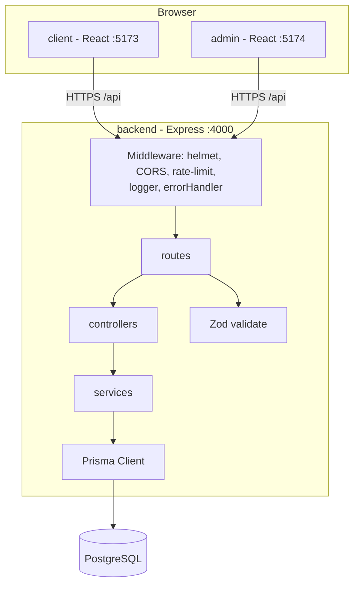
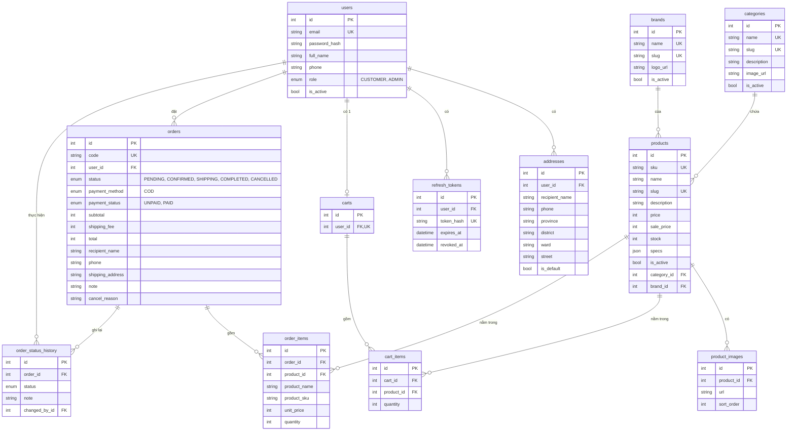
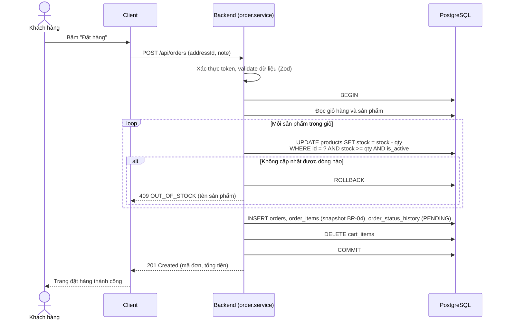
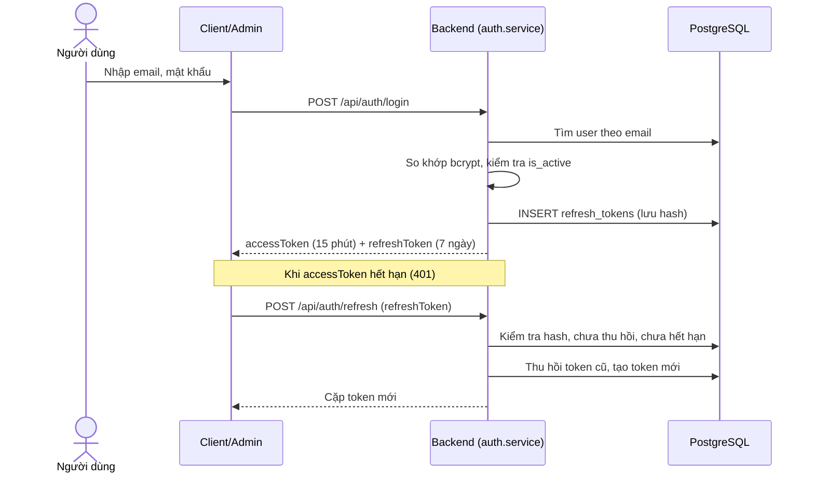
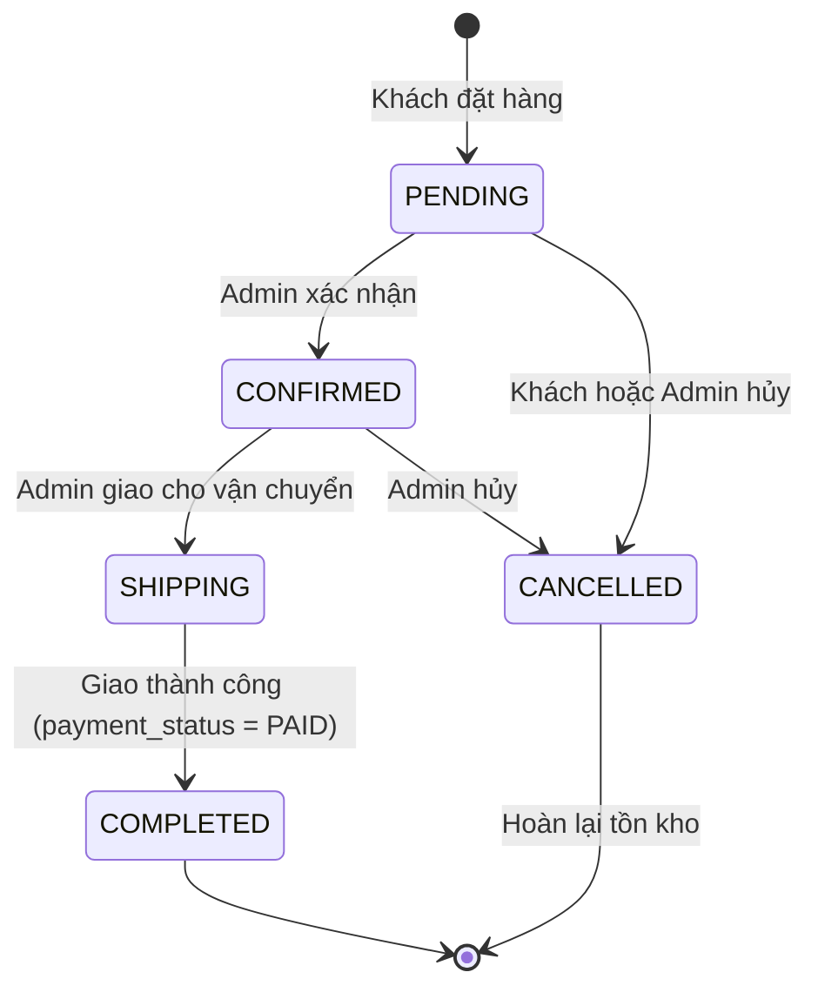

# Thiết kế hệ thống (SDD) - TechStore

Phục vụ rubric TC2.1. Sơ đồ dùng Mermaid (GitHub tự hiển thị). Mọi sơ đồ phải khớp mã nguồn: khi đổi code hoặc schema, cập nhật lại tài liệu này trong cùng commit.

Tài liệu liên quan: [SRS.md](SRS.md) · [DATA_DICTIONARY.md](DATA_DICTIONARY.md) · [schema.prisma](../backend/prisma/schema.prisma)

## 1. Quyết định kiến trúc và phương án đã cân nhắc

| Vấn đề            | Chọn                                                                   | Phương án khác đã cân nhắc                                | Lý do chọn                                                                                                    |
| ----------------- | ---------------------------------------------------------------------- | --------------------------------------------------------- | ------------------------------------------------------------------------------------------------------------- |
| Kiểu kiến trúc    | Monolith REST API + 2 SPA                                              | Microservices; Next.js SSR fullstack                      | Nhóm nhỏ, thời gian 6 tuần: monolith đơn giản, dễ triển khai và kiểm thử. Đề bài yêu cầu tách Client và Admin |
| CSDL              | PostgreSQL                                                             | MongoDB, MySQL                                            | Dữ liệu quan hệ rõ (đơn hàng, sản phẩm), cần transaction và ràng buộc CHECK cho tồn kho                       |
| Truy cập dữ liệu  | Prisma ORM                                                             | SQL thuần với `pg`, Sequelize, Knex                       | Có migration, schema là nguồn sự thật duy nhất và sinh được ERD; truy vấn tham số hóa chống SQL injection     |
| Xác thực          | JWT access token (15 phút) + refresh token (7 ngày, lưu hash trong DB) | Session cookie phía server; chỉ dùng access token dài hạn | SPA tách domain nên JWT tiện; refresh token lưu DB cho phép thu hồi khi đăng xuất hoặc khóa tài khoản         |
| Giỏ hàng          | Lưu trên server, yêu cầu đăng nhập                                     | Lưu localStorage cho khách vãng lai                       | Đơn giản, nhất quán giữa thiết bị; giảm khối lượng. Đánh đổi: khách chưa đăng nhập không thêm giỏ được        |
| Biến thể sản phẩm | Không có (mỗi cấu hình là một sản phẩm riêng, ví dụ iPhone 15 128GB)   | Bảng ProductVariant (màu, dung lượng)                     | Tiết kiệm thời gian; với quy mô đồ án đủ dùng. Có thể mở rộng sau                                             |
| Kiểu dữ liệu tiền | `Int` đơn vị VND                                                       | `Decimal`, `Float`                                        | VND không có phần lẻ; số nguyên tránh sai số làm tròn (BR-01)                                                 |
| Frontend          | React + Vite + Tailwind, React Query                                   | Create React App, Redux                                   | Vite nhanh; React Query lo việc gọi API, cache, trạng thái loading/lỗi nên không cần Redux                    |
| Kiểm thử          | Vitest (cả 3 phần), Supertest, Playwright (E2E)                        | Jest                                                      | Một công cụ cho mọi phần, cấu hình chung với Vite                                                             |
| Tách lớp backend  | route → controller → service → Prisma                                  | Gộp logic vào route                                       | Tách nghiệp vụ khỏi HTTP để dễ kiểm thử (rubric TC2.4)                                                        |

## 2. Sơ đồ ngữ cảnh (Context)

## 3. Sơ đồ thành phần (Component)

Cấu trúc thư mục backend khớp sơ đồ: `src/routes`, `src/controllers`, `src/services`, `src/middlewares`, `src/lib/prisma.js`, `src/config`, `src/utils`. Hiện có sẵn: middleware, route health, cấu hình và tiện ích; controllers/services được thêm theo từng tính năng.

## 4. Sơ đồ thực thể - quan hệ (ERD)

Khớp với `backend/prisma/schema.prisma` (các tính năng F00–F07). Review (F08), Wishlist (F08), Coupon (F09) chưa triển khai nên chưa có trong sơ đồ này.

Ghi chú: ngoài các cột trên, hầu hết bảng còn có `created_at` và `updated_at`. Ràng buộc CHECK (tồn kho không âm, giá dương, số lượng ≥ 1, tiền không âm) nằm ở cuối file migration `20261021000000_init`.

## 5. Sơ đồ tuần tự

### 5.1 Đặt hàng (F06, US-16)

Cách trừ kho `UPDATE ... WHERE stock >= qty` là một câu lệnh nguyên tử, nên nhiều đơn đồng thời không thể làm tồn kho âm (NFR-04); ràng buộc CHECK là lớp bảo vệ thứ hai.

### 5.2 Đăng nhập và làm mới phiên (F01, US-02, US-03)

## 6. Máy trạng thái đơn hàng (BR-06)

## 7. Sơ đồ triển khai (Deployment)

Nền tảng cụ thể chưa chốt (ưu tiên gói miễn phí); sơ đồ dưới là phương án dự kiến và sẽ cập nhật khi deploy.

Môi trường local: `docker-compose.yml` chạy PostgreSQL; backend và hai frontend chạy bằng `npm run dev:*`.

## 8. Nhật ký thay đổi thiết kế

| Ngày       | Thay đổi                                                                              | Lý do                                          |
| ---------- | ------------------------------------------------------------------------------------- | ---------------------------------------------- |
| 21/10/2026 | Chốt schema ban đầu F00–F07; không dùng biến thể sản phẩm; giỏ hàng yêu cầu đăng nhập | Phù hợp quy mô 6 tuần, giảm rủi ro trễ tiến độ |
